# The Loom: Reliquary of Legends — an RSL / SWGOH-style hero battler in pixel art

A turn-based hero collector in the style of **RAID: Shadow Legends** and **Star Wars: Galaxy of Heroes**, built to answer one question: *can it look and play that well with 2D pixel art?* Every sprite, animation, effect, tile, backdrop, icon, the logo, the world map and the font are **generated by code** in this repo (`npm run art`), from one palette and one light.

> **Status: built from Jakub's own design.** The name and the logo are final: **The Loom: Reliquary of Legends** (code name TLROL), high fantasy with a gothic arcane look. Since 2026-10-10 its content comes from his design record ([docs/DESIGN_DECISIONS.md](docs/DESIGN_DECISIONS.md)): the premise of the broken loom, the affinities, rarities, roles and factions with their standards, twenty-four champions (their names, looks and kits), five areas (the Fracture Reach from his working notes and brief, the Verdant Grove's background on his brief, the Moonlit Basin, Earth Scars and the Snowy Mesa named and described by him), the world map, the Weaver Matrix and summoning. What he has not designed yet is marked as a stand-in where it lives: the champions' stats and skill numbers, seven Elites' affinities, the enemies, the stage powers and the placeholder stages, and every detail his descriptions did not name. The engine, the tools and the guardrails stay.

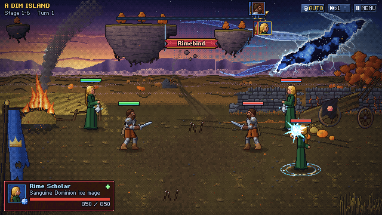

- **26 champions** in four factions, each with idle, run, every skill, hurt, death and a victory pose, rendered for both facings:
  - *Azure Crown*: Captain Gareth, the Skirmisher, the Lineholder, the Quartermaster, Emissary Handlings, a proud standard-bearer, the Associate, a mage with a staff of white motes, and the Paladin, the first Heroic, a young knight in silver plate with a double-cross shield and a burning sword.
  - *Sanguine Dominion*: the Rime Scholar, the Dominion Medic, the Bloodhound (the first on four legs), the Enforcer, Red Cloak, a bald knight in plate with a silver zweihander, the Black Rhino, a great black bull with prosthetic tusks, and Chief Engineer CJ, a Heroic, a fat forge-master in an orange helm with a sparking two-handed hammer.
  - *Court of Root*: the Follower, a grey wolf, the Walking Bush, a small ent of a bush, the Wild Speaker, a tattooed man with a long stick, the Jungle Herder, a hunchbacked herder with a crook and a bell, the Grove Keeper, an old druid with antlers, and Big Ears, a small big-eared creature with a blowpipe.
  - *Ashveil Reign*: the Skeleton, a short skeleton with a rusty sword, the Rot Hulk, a big, fat abomination of patched flesh, the Bellringer, a very tall skeleton with a golden bell, the Necromancer, a hooded man in black with a book of the dead, the Automated Soul, a headless archer skeleton in azure and gold plate, and Irving Wellbington, a dwarf skeleton with a horned helmet behind a big round shield.
- **Five combat backgrounds**, one for each area, alive with calm motion:
  - the *Fracture Reach*: dawn in autumn after a raid, a haystack burning, a broken windmill, bulky floating islands and a rift torn in the cosmos;
  - the *Verdant Grove*: a jungle ruin at midday below a table mountain, a wall carved with a feathered serpent, macaws and butterflies;
  - the *Moonlit Basin*: night under the moon, glowing moss, glass reeds and tide-pools, now and then a shooting star;
  - *Earth Scars*: the steppe by day, yurts with chains of flags on very long poles, wild yaks, two snowy peaks and a zeppelin;
  - the *Snowy Mesa*: a snowy tabletop mountain before sunset among many more, joined by cables hung with candles, a castle breathing purple dust, the arbiter's statue with his sword and a snowstorm coming on.
- **A campaign** of five areas on a painted world map three screens wide that grows east area by area: from a rift in the west through the Fracture Reach's village in its autumn fields, the forest of the Verdant Grove, the Moonlit Basin under its own night and the steppe of Earth Scars with its two ravines, to the brink beyond which the Snowy Mesa's tabletop mountains rise out of a sea of cloud. One node per area opens its list of stages (drag the map, step between areas with the arrows, or press `M` for the whole world). Zone 1 holds 10 stages; Zones 2 to 5 hold 10 placeholder stages each, to see and test them. The second champion joins after the first battle; every other champion is summoned.
- **A Weaver Matrix** for every champion: six named slots in two triangles holding Thread Spools, each with a main stat and strands, and eight Weave Patterns that two spools of a kind weave, on the champion page's MATRIX tab.
- **Weaving**, the storage of every spool: spools drop from every campaign stage, each area holding two Weave Patterns, and wait here as cards in groups by pattern, one grade per row, filtered by slot and by state; choose one to read it, weave it into a champion (the champion, then the slot, with a preview of the stats it changes and the patterns it completes), take it out or unravel it. New finds wear the NEW badge.
- **A main menu that is a place**: the Sanctum, an island adrift under the broken celestial Loom, its golden rim cracked open over a ringed planet, threads of starlight hanging from it and its cloth streaming from the break; you go on by clicking its places (the Starbridge Gate, the Reliquary, the Weaver's Spire, the Observatory, an astrolabe), and a different few of your champions stand on its plaza each time.
- **Challenges**: the Herald's Board on its own drifting rock leads to quests in three tabs, Daily, Persistent and the **Journey**, a pathway across the screen where the Loom's thread runs through a knot for every quest, woven gold as each is claimed: claim one to open the next.
- **A tutorial for new accounts**, made with driver.js: the screen dims round the spot to click, gold corners breathe round it and a gloved hand points at it, while a card in the game's own pixel font says why; it leads from the Sanctum through the campaign and a first battle (the turn meter, a skill, a target, a cooldown) to the Challenges, where finishing it is the Journey's first quest. It can be skipped, and played again from the Journey. A later lesson walks the first summon, once its Stardust is in.
- **Summoning at the Wishing Star**: every victory finds Stardust, 100 Stardust merge into a Soulstar, and a Soulstar summons a champion you do not have yet: 70% Common, 25% Elite, 5% Heroic. Wish for a faction and a role first and the champions it names grow likelier (never certain); the Wishing Star, hung in the Sanctum's sky on a thread of the Loom, shows the odds, your wish's chance and every champion still scattered, and a summon draws the light in, turns it the colour of the rarity that answers and opens on the champion's ceremony.
- **A collection** of champions in groups by faction, the rarest first and one rarity per row, filtered by affinity and by class, with locked silhouettes, and a detail page with every animation and skill.
- **The Academy**: an in-game codex that teaches combat, the turn meter, damage, affinities, all buffs, debuffs and special mechanics, with live demonstrations.
- **Real mechanics**: turn meter, A1/A2/A3 cooldowns, 15 statuses, the affinity cycle (Ember beats Bloom, Bloom beats Tide, Tide beats Ember), accuracy against resistance for debuffs, counterattacks, dispels, lifesteal, execute, turn meter boosts, passives (Undying, Overdrive, Rebuke, which answers a critical hit, stat passives that raise a stat in every battle, Shields given to the frailest at the end of a turn, to an ally just struck or to the struck one himself, a crit that grows as allies fall, Poison answering a blow, Regen answering a debuff, and Taunt with a heal answering a critical hit that leaves its holder standing), a cleanse, a blow that heals its user, a buff placed before the blow, a fallen ally raised, bosses, stars, auto battle and speed controls.
- **Guardrails** that keep new content consistent: balance norms and a balance simulator, content tests, an art audit, and two project skills for adding champions and backgrounds.

| | |
| --- | --- |
| 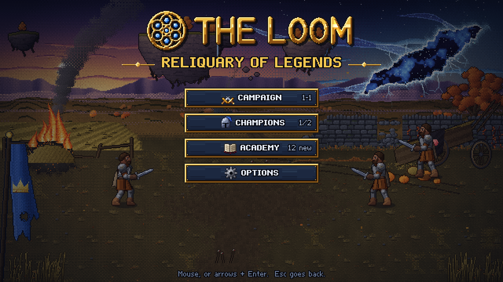 | 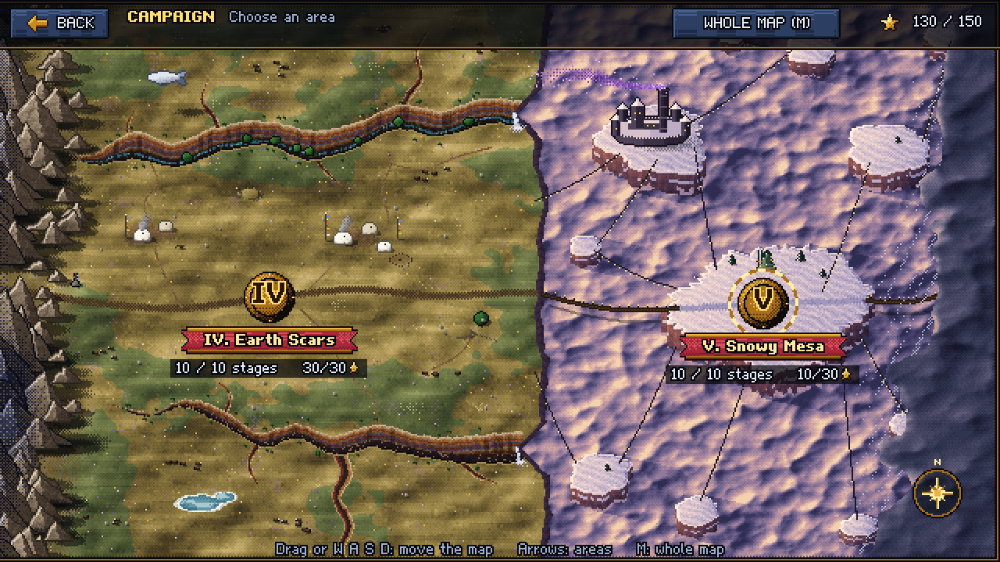 |
| 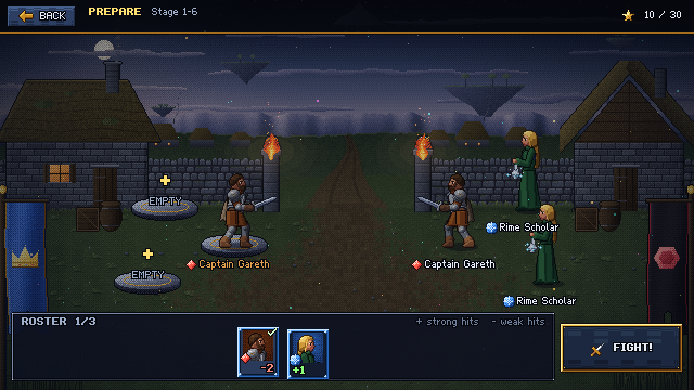 | 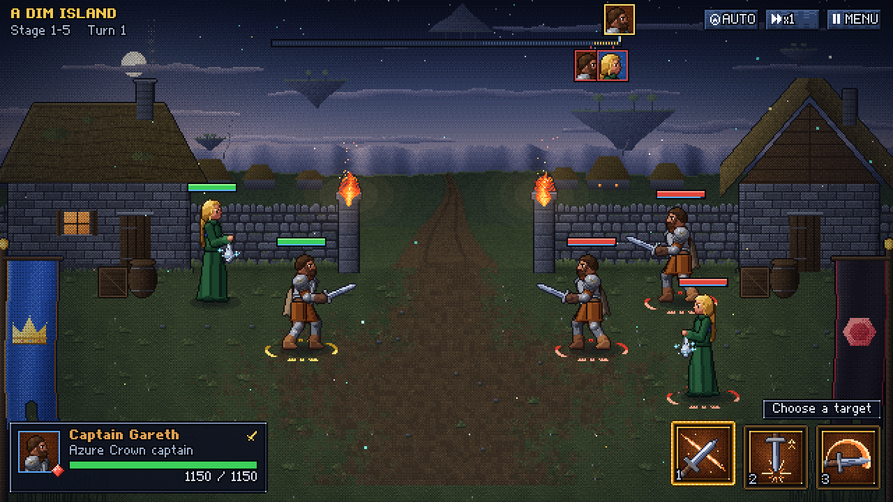 |
| 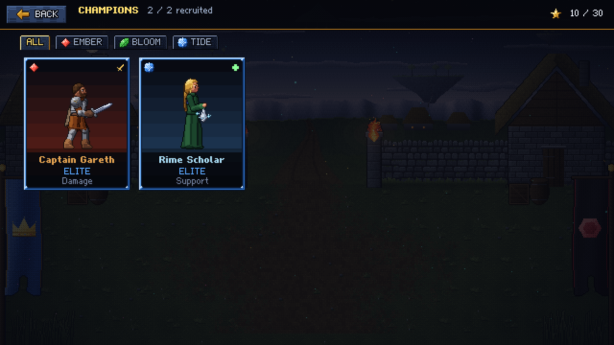 | 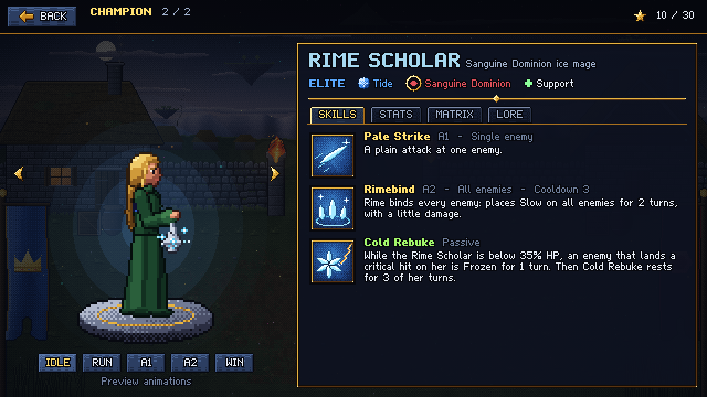 |
| 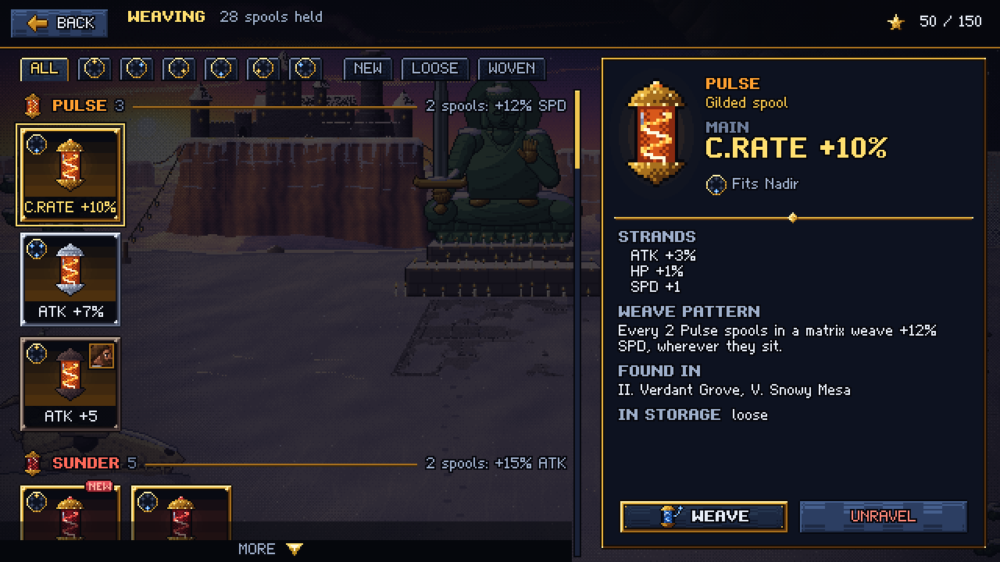 | 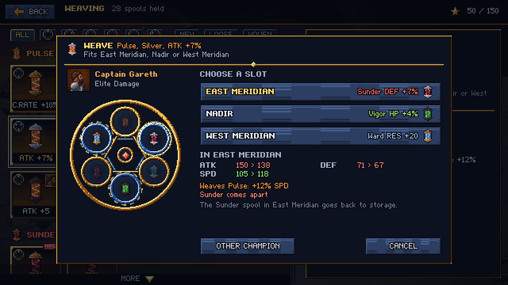 |
| 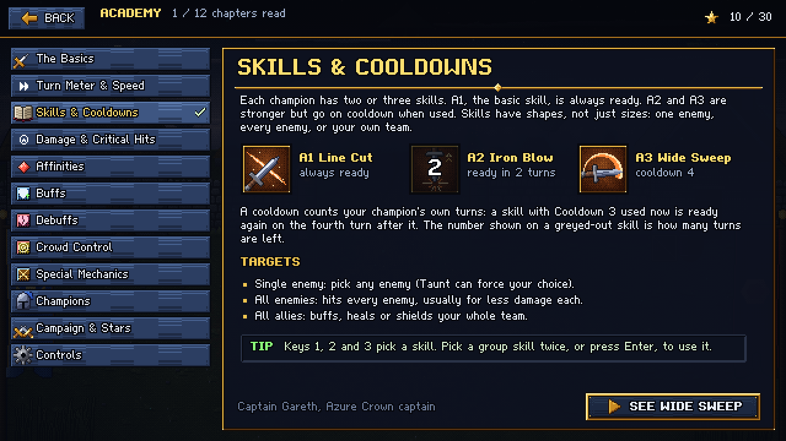 | 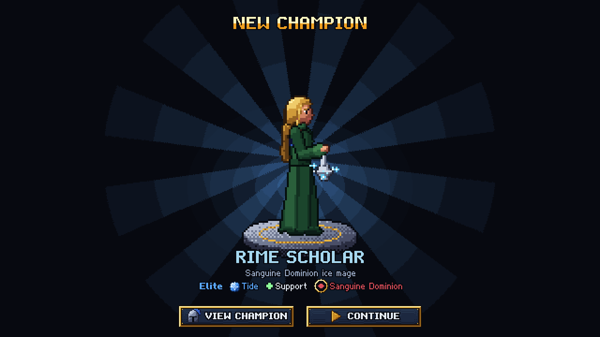 |
| 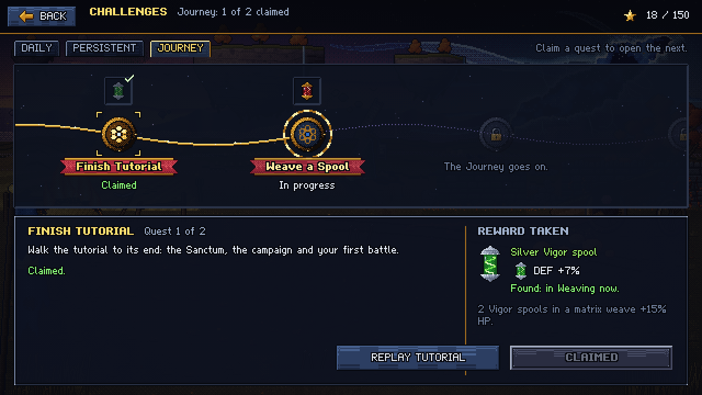 | 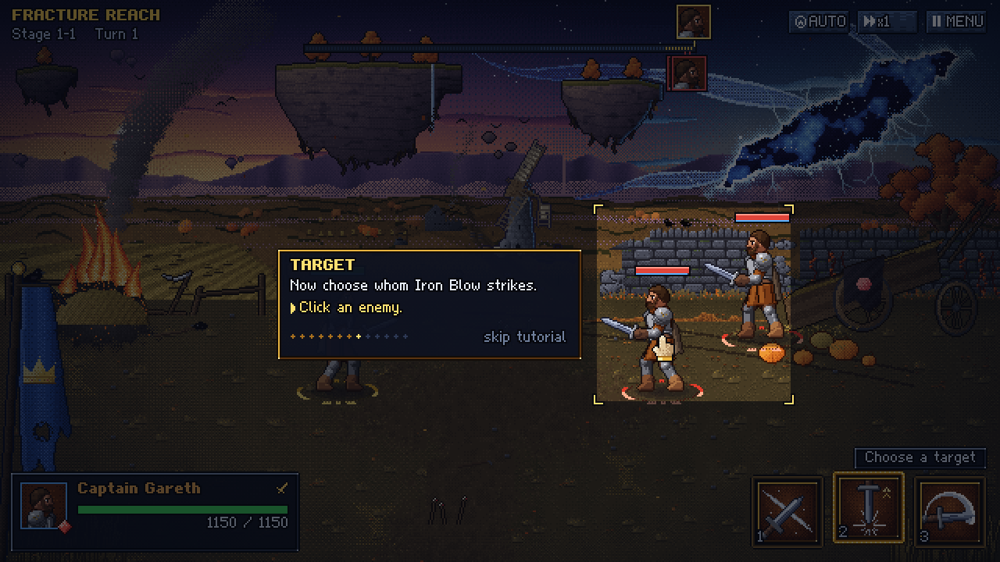 |
| 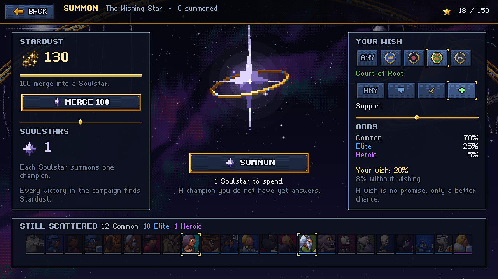 | 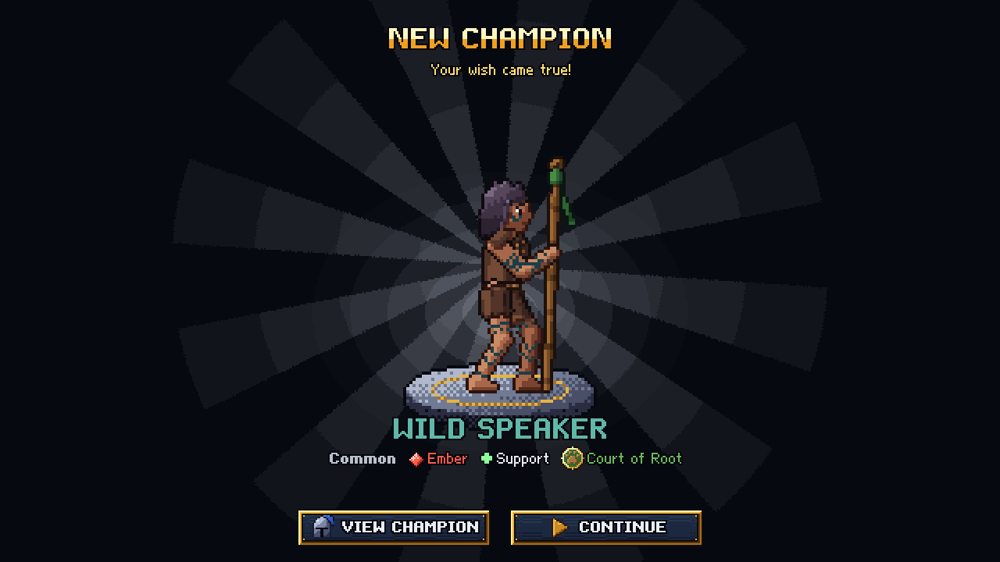 |

## Run it

```bash
npm install
npm run dev
```

Open http://localhost:5173. The sprite gallery (every animation, effect and icon) is at http://localhost:5173/gallery.html.

| Input | Action |
| --- | --- |
| mouse | everything: click skills, targets and buttons; hover anything for a tooltip |
| `1` `2` `3`, arrows, `Enter` | pick a skill, cycle targets, confirm |
| `A`, `S`, `Esc` | auto battle, speed x1/x2/x3, pause menu (and back in menus) |
| campaign map | drag to move; arrows jump between areas; `W` `A` `S` `D` or `Shift` + arrows slide the map; `M` shows the whole world |
| arrows + `Enter` in menus | move between buttons, activate |

Deep links: `?screen=campaign|team|battle|collection|champion|weaving|academy|challenges|options|recruit|summon`, `&tab=daily`, `?tutorial=1` (start the tutorial; `0` keeps it and its lessons away from a fresh game, `summon` starts the lesson on the first summon), `?stardust=250`, `?soulstars=2` (set what the save holds), `&stage=1-5`, `&team=captain_gareth,rime_scholar`, `&champion=rime_scholar`, `&chapter=buffs`; `?demo=<skill_id>` loops one skill; `&zone=zone5` (a battle or team select on another area's background), `&hp=0.1` (scales the enemies' max HP); `?unlockall=1`, `?progress=1-4` (clear up to a stage), `?reset=1`, `?spools=1` (a sample stock of Thread Spools, added once), `?skyflash=1` (a zone's rare flash in its sky every few seconds).

## The champions

All twenty-six are Jakub's ([docs/DESIGN_DECISIONS.md](docs/DESIGN_DECISIONS.md) 8, Starter Heroes, 12, the Skirmisher, 13, the Lineholder, 14, the Quartermaster, 15, the Enforcer, 16, the Bloodhound, 17, the Dominion Medic, 18, the Follower, 19, the Walking Bush, 20, the Wild Speaker, 21-27, the seven Elites of his proposals of 2026-10-17, 28, the Skeleton, 29, the Rot Hulk, 30, the Bellringer, 31, the Necromancer, 32, the Automated Soul, 33, Irving Wellbington, and 34, the Paladin): names, looks, kits and what each one teaches. Their stats and the numbers in their skills are stand-ins until he sets them, and so are the seven Elites' affinities ([docs/MECHANICS_GUIDE.md](docs/MECHANICS_GUIDE.md) 9).

| | Champion | Kit |
| --- | --- | --- |
| 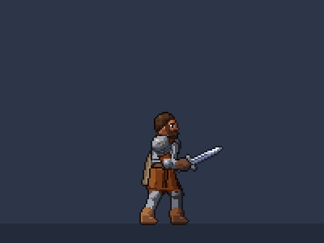 | **Captain Gareth**. Elite Ember Damage, Azure Crown. A captain in dull steel field armour over a deep amber-brown coat, with a short faded cloak and a plain straight sword; his cuts leave a plain white streak. Joins from the start; teaches how damage works. | **Line Cut**: one cut at one enemy. **Iron Blow**: a heavy strike, then ATK Up on himself for 2 turns (after the hit; cooldown 3). **Wide Sweep**: one sweep that hits every enemy, damage only (cooldown 4). |
| 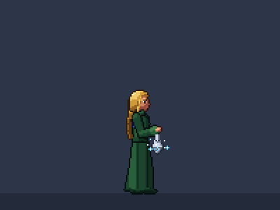 | **Rime Scholar**. Elite Tide Support, Sanguine Dominion. Tall and still, long blonde hair, a dark green dress with a blue circle on the back, a censer with ice flakes flowing round it. Joins after the first battle (1-1); teaches that statuses exist. | **Pale Strike**: a plain attack. **Rimebind**: Slow on every enemy, with a little damage (cooldown 3). **Cold Rebuke** (passive): below 35% HP, an enemy whose critical hit lands on her is Frozen for 1 turn; then it rests for 3 of her turns. |
| 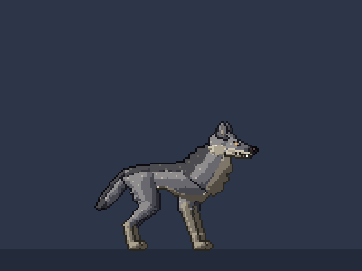 | **Follower**. Common Tide Damage, Court of Root, its first champion. A lean grey wolf on four legs, a little wild: a shaggy ruff, erect ears, a long bushy tail carried low, no collar. Summoned at the Wishing Star. | **Snap** (A1): darts in and snaps at one enemy. **Rend** (A2): leaps on one enemy and tears at its guard, a 50% chance of DEF Down for 2 turns (cooldown 4). |
| 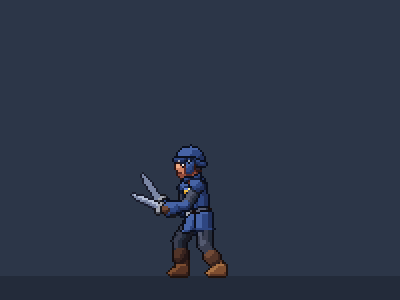 | **Skirmisher**. Common Bloom Damage, Azure Crown. A slight, light-armoured man in blue leather with the Azure Crown's insignia, a leather helmet and two short swords; weaker-looking than the starters. Summoned at the Wishing Star. | **Twin Cut** (A1): two quick cuts at one enemy, one with each sword; it always hits twice. No A2. |
| 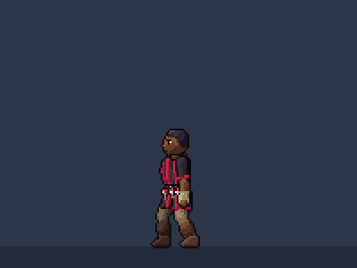 | **Dominion Medic**. Common Tide Support, Sanguine Dominion. A field medic with no weapon, a tunic in red and black stripes and healing potions hanging round his waist. Summoned at the Wishing Star. | **Tonic** (A1): uncorks a potion and raises it; every ally heals by 10% of his max HP. Nothing else. |
| 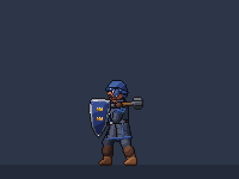 | **Lineholder**. Common Tide Tank, Azure Crown. A big man behind a big dark-blue shield with two small gold crowns, a mace of dark iron on a wooden handle resting on his shoulder, a blue leather helmet like the Skirmisher's, a dark quilted coat with blue stripes. Summoned at the Wishing Star. | **Guard Cut** (A1): keeps the shield up and strikes one enemy with the mace over its rim. **Brace** (A2): sets his feet behind the shield; DEF Up on himself for 2 turns (cooldown 3). |
| 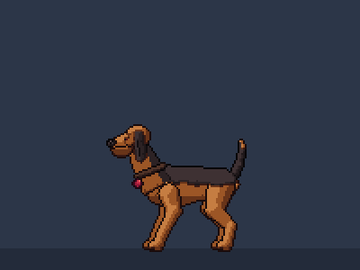 | **Bloodhound**. Common Ember Tank, Sanguine Dominion. The first champion on four legs: a big black-and-tan bloodhound with long hanging ears and a black collar bearing the Dominion's red hexagon. Summoned at the Wishing Star. | **Bite** (A1): lunges at one enemy and bites. **Bay** (A2): bays at the enemy and draws it to himself, Taunt on himself for 1 turn (cooldown 4). |
| 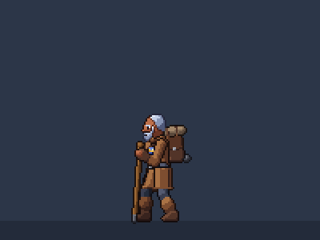 | **Quartermaster**. Common Bloom Support, Azure Crown. A grey-haired man of the road in a long brown leather coat, a big pack on his back, the Crown's blue badge on his chest and a tall walking stick. Summoned at the Wishing Star. | **Stick Rap** (A1): a plain rap of the walking stick. **Field Rations** (A2): every ally heals by 15% of his max HP, then the ally lowest on HP (not himself) gains 15% Turn Meter (cooldown 3). |
| 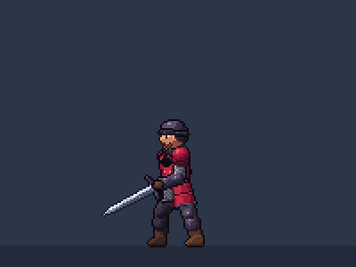 | **Enforcer**. Common Ember Damage, Sanguine Dominion. A soldier in crimson half armour with the black hexagon on his chest, a plain cap of dark iron and a long bastard sword held in both hands. Summoned at the Wishing Star. | **Heavy Cut** (A1): a two-handed cut of the long sword at one enemy. **Keen Edge** (passive): +10% C.RATE in every battle. No A2. |
| 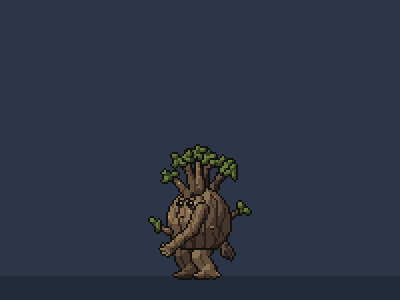 | **Walking Bush**. Common Bloom Tank, Court of Root. A small, weak ent grown from a bush: a fat round body of woody stems on stumpy root legs, branches standing up from his top, no head, long arms of root. Summoned at the Wishing Star. | **Root Lash** (A1): lashes one enemy with a root hand. **Thicket** (A2): DEF Up for 1 turn on himself and one chosen ally (cooldown 3). |
| 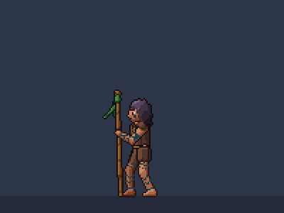 | **Wild Speaker**. Common Ember Support, Court of Root. A barefoot tribesman with tattoos on his bare arms and legs, his torso in dark leather, and a long stick with two green ribbons tied at its head. Summoned at the Wishing Star. | **Staff Blow** (A1): drives the head of his long stick into one enemy. **Quell** (A2): an overhead blow of the stick on one enemy, then a 50% chance of ATK Down for 2 turns (cooldown 4). |
| 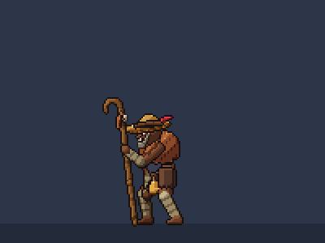 | **Jungle Herder**. Elite Tank, Court of Root (his affinity is a stand-in). An old herder of the jungle's beasts bent under a great hump in a mantle of russet hide, a wide straw hat with a red feather, a long crook with its hook curled over, a bronze bell swinging at his belt. Summoned at the Wishing Star. | **Crook Strike** (A1): brings the hook of his crook down on one enemy. **Bellwether** (A2): drives the crook into the ground and rings his bell; Taunt for 1 turn and Counterattack for 2 on himself (cooldown 4). **Herder's Ward** (passive): at the end of every second turn of his, a Shield of 10% of his max HP for 1 turn on the ally with the lowest max HP, himself included. |
| 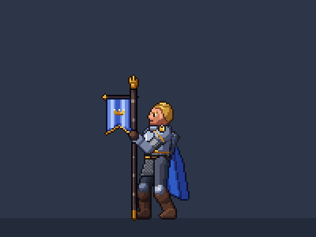 | **Emissary Handlings**. Elite Tank, Azure Crown (his affinity is a stand-in). Tall and proud, in polished steel edged with gold over mail and a long bright-blue cloak, carrying the Crown's standard on a pole taller than himself and no other weapon. Summoned at the Wishing Star. | **Banner Strike** (A1): swings the pole into one enemy, a 20% chance of Stun. **Rallying Standard** (A2): plants the standard; DEF Up on all allies for 2 turns (cooldown 5). **Unbroken Flag** (passive): when an enemy strikes an ally, a 50% chance of a Shield of 15% of his max HP on it, after the hit. |
| 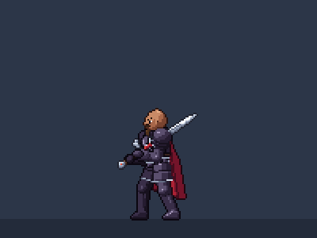 | **Red Cloak**. Elite Damage, Sanguine Dominion (his affinity is a stand-in). A bald knight with a goatee in blackened plate and a long scarlet cloak, an ornamented silver zweihander resting on his shoulder. Summoned at the Wishing Star. | **Cleave** (A1): the zweihander down through one enemy. **Crimson Blade** (A2): the blade glows crimson for a rising cut, a 50% chance of Burn for 2 turns (cooldown 3). **Onrush** (A3): a lunge point first, then SPD Up on all allies for 2 turns (cooldown 5). |
| 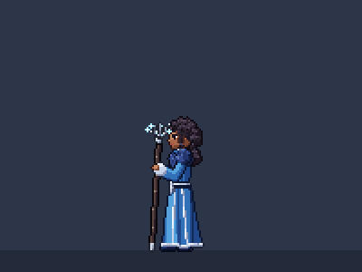 | **Associate**. Elite Support, Azure Crown (her affinity is a stand-in). A mage in a full azure robe with white stripes and a woven cape of dark blue over her shoulders, dark curls, a staff of dark wood whose head opens in three silver tines with white motes circling it. Summoned at the Wishing Star. | **Mote Bolt** (A1): the motes fly at one enemy in one bolt, a 50% chance of ATK Down for 1 turn. **Quickening** (A2): SPD Up for 2 turns and ATK Up for 1 on all allies (cooldown 5). **Bitter Motes** (passive): when an enemy attack hits her, a 35% chance of Poison on that enemy for 1 turn. |
| 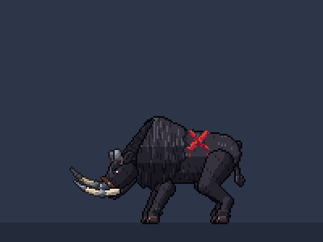 | **Black Rhino**. Elite Tank, Sanguine Dominion (his affinity is a stand-in). A great black bull in a shaggy mane, his horns sawn to iron-capped stumps and two long tusks of ivory and iron strapped to his muzzle, a red X his master painted across his back. Summoned at the Wishing Star. | **Gore** (A1): a charge and a thrust of the tusks, a 20% chance of Stun for 1 turn. **War Bellow** (A2): DEF Up on all allies for 2 turns and Counterattack on himself for 2 (cooldown 5). **Thick Hide** (passive): after every enemy attack that hits him, a Shield of 10% of his max HP on himself for 1 turn. |
| 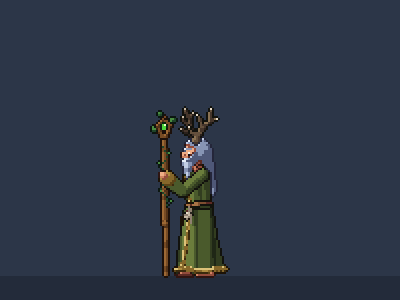 | **Grove Keeper**. Elite Support, Court of Root (his affinity is a stand-in). An old druid with branching antlers, long grey hair and beard, a moss-green robe worked with old gold, a gnarled staff holding a seed of green light. Summoned at the Wishing Star. | **Thornburst** (A1): thorns burst from the ground round one enemy, and he heals by 7% of his max HP. **Cleansing Rite** (A2): every debuff off one ally (cooldown 3). **Keeper's Balm** (passive): when an enemy places a debuff on an ally, a 35% chance of Regen on it for 1 turn. |
| 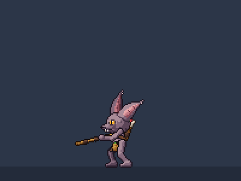 | **Big Ears**. Elite Damage, Court of Root (his affinity is a stand-in). A small beast of the undergrowth with a big head, a pointed snout, a slit-pupilled amber eye and fangs, two big ears curving back, a quiver of darts and a blowpipe longer than he is tall. Summoned at the Wishing Star. | **Poison Dart** (A1): a dart at one enemy, a 35% chance of Poison for 1 turn. **Dart Volley** (A2): three quick darts at every enemy, then Heal Block on all of them for 2 turns (cooldown 5). **Hidden in the Undergrowth** (passive): +15% C.RATE for each fallen ally, up to +30%. |
| 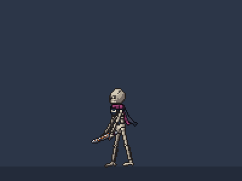 | **Skeleton**. Common Tide Damage, the Ashveil Reign's first champion. The skeleton of a short soldier, no armour, a rusty notched sword in his hand; strips of charcoal and plum cloth wound round his neck, a pennant of the Reign's standard hanging at the front. Summoned at the Wishing Star. | **Rusty Hack** (A1): a hack of the rusty sword at one enemy. **Bare Bones** (passive): +20 RES in every battle. No A2. |
| 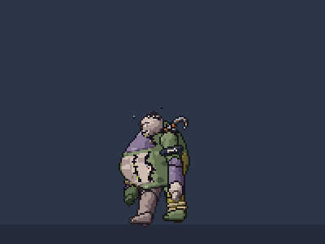 | **Rot Hulk**. Common Ember Tank, the Ashveil Reign's second champion. A big, fat abomination sewn together from the dead: patches of rotted green, corpse pale, bruise purple and jaundiced yellow stitched with black thread, a rusty meat hook stuck in his hump, mismatched arms ending in great mitts, flies circling his small sunk head. Summoned at the Wishing Star. | **Putrid Slam** (A1): brings both fists down on one enemy, a 25% chance of Poison for 2 turns. No A2. |
| 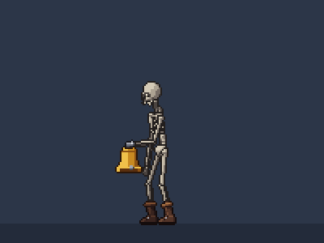 | **Bellringer**. Common Ember Support, the Ashveil Reign's third champion. A very tall, thin skeleton with no lower jaw, in old boots, a big golden bell fixed to his arm in place of a hand and held out before him like a lantern; he keeps watch for the enemy. Summoned at the Wishing Star. | **Warning Toll** (A1): points the enemy out and tolls the bell; one ally (another while one stands) gains a Shield of 10% of his max HP for 1 turn, and he heals by 10% of his max HP. **Last Peal** (passive): the first time he drops below 50% HP, DEF Up for 2 turns. No A2. |
| 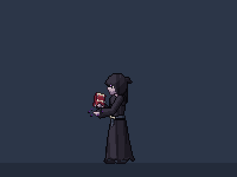 | **Necromancer**. Elite Bloom Support, the Ashveil Reign's first Elite. A tall, gaunt man in a black robe, his hood over his pale head so only a little of his face shows; a book of the dead bound in maroon in one hand, small black motes circling the other. Summoned at the Wishing Star. | **Grave Chill** (A1): flings the motes at one enemy, a 35% chance of Slow for 1 turn. **Plague Verse** (A2): reads a verse over one enemy, Poison for 2 turns, and SPD Up for 2 turns on all allies (cooldown 4). **Raise Dead** (A3): one fallen ally, chosen at random, gets up with 30% of its max HP (cooldown 6). |
| 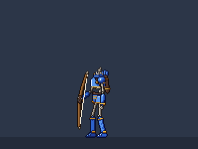 | **Automated Soul**. Elite Tide Damage, the Ashveil Reign's second Elite. An archer skeleton with no head, in shiny azure plate trimmed with gold, the neck's last bones broken off in an empty gorget with a pale light in it; a wooden longbow nearly as tall as he is, a quiver at his back. Summoned at the Wishing Star. | **Unerring Shot** (A1): an arrow at one enemy. **Sundering Volley** (A2): a volley into the sky that comes down on all enemies, DEF Down for 2 turns (cooldown 4). **Pinning Shot** (A3): ATK Up on himself for 2 turns first, then an arrow at full draw at one enemy, Stun for 1 turn (cooldown 4). |
| 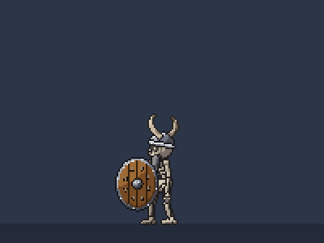 | **Irving Wellbington**. Elite Bloom Tank, the Ashveil Reign's third Elite. A dwarf skeleton, short and broad, a braided grey beard on his jaw, under a big iron helmet with two great horns; behind a big round shield of old planks, an iron rim and boss and a ring of ancient runes with a pale light in them. Summoned at the Wishing Star. | **Shield Bash** (A1): the face of his shield into one enemy, a 35% chance of Slow for 1 turn. **Bulwark Slam** (A2): the rim brought down on one enemy, then DEF Up for 2 turns and Counterattack for 1 on himself (cooldown 4). **Old Grudge** (passive): when an enemy's critical hit leaves him standing, Taunt for 1 turn and a heal of 20% of his max HP. |
| 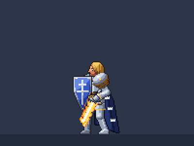 | **Paladin**. Heroic Ember Tank of the Azure Crown, the roster's first Heroic, the reward of a quest line to come; summoned at the Wishing Star meanwhile. A tall young knight in silver plate with wide pauldrons, bareheaded and blonde, a long dark-blue cloak with three white crowns, a big Swiss-shaped shield with a white double cross, and a wide sword burning white-gold, its flames alive in every frame and its light spilling round it in battle. *Searing Cut*: one enemy, ATK Down for 1 turn. *Beacon*: the sword raised high, DEF Up on all allies and Slow on all enemies for 2 turns, no damage, and a third of his next turn already won. *Trial by Fire*: Taunt and Regen on himself, then a sweep of fire through every enemy. *Unbowed*: +50 RES in battle. |
| 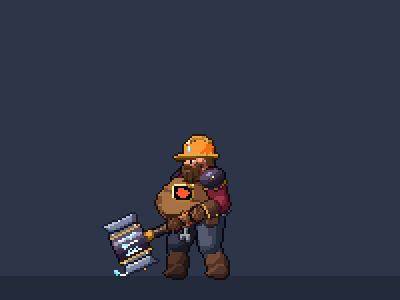 | **Chief Engineer CJ**. Heroic Bloom Tank of the Sanguine Dominion. A fat forge-master in a leather apron, a long beard and a loud orange helm, a belt of gears, a great rune-cut two-handed hammer throwing sparks. Two blows that may stun, a decree that guards his line and slows the enemy, a blow that sends the charge through the ground, and an eye that lifts a debuff from every ally at the start of his turn. |

### Skill icons (one row per champion: A1, A2, A3 or the passive)


## The world

The campaign is a line of areas crossed from left to right, each a node on the map that opens its list of stages:

- **I. Fracture Reach** (Zone 1) follows Jakub's working notes: ten stages in the arc contact, the settlement, escalation, the turning point and leaving (the notes are not locked). Its enemies are copies of the two starters until enemies are designed; the first clear of 1-1 brings the Rime Scholar, the only champion a stage brings.
- **II. Verdant Grove** (Zone 2): ten placeholder stages on its jungle-ruin background, painted on his brief, so the area can be tested in game.
- **III. Moonlit Basin** (Zone 3), named and described by Jakub: ten placeholder stages on its night background, walking his description from the grove's roots to the eastern hills.
- **IV. Earth Scars** (Zone 4), named and described by Jakub: ten placeholder stages on its steppe by day, walking his description from the ravines to the zeppelin in its sky.
- **V. Snowy Mesa** (Zone 5), named and described by Jakub: ten placeholder stages on the snowy top of a tabletop mountain before sunset, walking his description from the mesa's top to the arbiter with his sword.

From Zone 2 on the stages' enemies are copies of the roster's champions. Enemies and stage powers are stand-ins until Jakub dictates them. Every victory finds Stardust for the Wishing Star: 20 in the Fracture Reach and 5 more in each area beyond it, 10 more when nobody falls. The map grows east area by area; the overview (`M`) shows the whole world on one screen.

| Fracture Reach |
| --- |
|  |
| Dawn in autumn, the morning after a raid: on the left a stubble field, a haystack burning and the Azure Crown's torn standard; on the right a broken dry-stone wall, an autumn tree and a hay cart tipped over with a wheel off and the Sanguine Dominion's standard snapped across it. In the middle field a broken windmill beside the burnt farm and the farm's well, ravens wheeling over them and over the burning field, tools left in the fields. Above, the sun rising between lilac peaks, bulky floating islands, and a rift torn in the cosmos, slowly shedding blue and white sparks and waving veils of cosmic fabric; now and then the sky lights up in a strange colour. |

| Verdant Grove |
| --- |
|  |
| A jungle ruin at midday: the sun high in the upper left breaking through the canopy in slow beams; far off a table mountain with a waterfall, a stepped temple at the head of its great stair and a tower of cloud behind it; a colonnade of carved columns on its terrace, a temple pyramid half swallowed by the jungle. On the right a wall carved with a feathered serpent, its great head resting open-jawed at the wall's end, a stone jaguar before it; on the left a colossal stone head sinking into the earth under a giant tree. The floor is an old paved court lifted by roots and taken by moss. Clouds drift, the waterfall falls, sunbeams breathe, macaws wheel, butterflies flutter and pollen drifts in the light. |

| Moonlit Basin |
| --- |
|  |
| Night beyond the Verdant Grove: the full moon in a faint ring, the grove's last trees in silhouette on the left with their roots trailing over the silver sand, the eastern hills' sharp crags on the right, a long pool holding the moon's path. The floor is twilight-moss over sand rippled by the tides, with three clear tide-pools, glass reeds swaying round them and glowing flora at their shores; dust-motes of light drift in soft pearl halos, the pools shimmer and ripple, stars twinkle, and now and then a shooting star crosses the sky. |

| Earth Scars |
| --- |
|  |
| The steppe at midday beyond the eastern hills: far off, a little left of the middle, a very big mountain with a snowy peak and its lower twin on its right, a banner of cloud on the summit; a deep ravine comes in from the left, its far wall banded in ochre, rust and clay, and a second one shows far off on the right. In the middle a camp of yurts with very long poles flying chains of small flags in five colours, smoke from their stovepipes; wild yaks graze nearby, one walking to and fro; a cairn of stones with blue scarves on the right. The floor is sun-dried grass with a cart track, stones and feather grass in the corners. Clouds drift, a zeppelin crawls across the sky, flags and scarves stream, gusts run through the grass, eagles circle and feather-grass seeds sail by. |

| Snowy Mesa |
| --- |
|  |
| The snowy top of a tabletop mountain before sunset: the sun low on the left, mesas all round rising out of a sea of cloud, cables hung with candles sagging between them; on the left mesa a castle whose huge chimney breathes a stream of purple dust; from the upper right a snowstorm comes on, veils of snow beneath it. In the middle the arbiter, a seated bronze colossus like a Buddha, a great sword upright in his right hand, his left raised, candles burning on his plinth; two mountain pines bent by the wind, the old flagstones of a terrace before him, swords left in the snow, a stone lantern, a dragon's skull half buried at the front left. The candles flicker, the dust streams away with its motes, snow falls in the veils and lightning glows in the storm, the pines and lanterns sway, spindrift runs over the snow and flurries blow in ahead of the storm. |

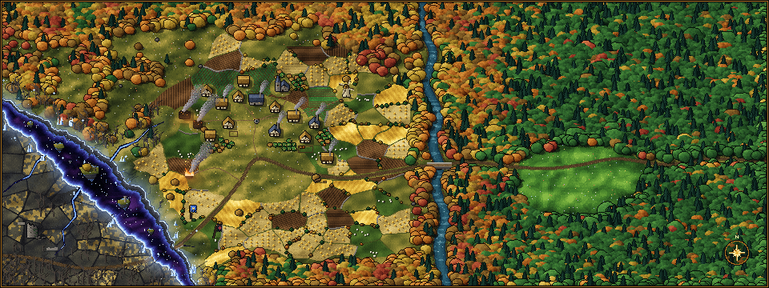

## Guiderails

| Document | What it fixes |
| --- | --- |
| [docs/DESIGN_DECISIONS.md](docs/DESIGN_DECISIONS.md) | Jakub's design record, the one source for content: the premise, enums and factions, every champion's brief, the areas and the map, the Weaver Matrix, the combat rules, and what is not decided yet |
| [docs/ART_GUIDE.md](docs/ART_GUIDE.md) | grid and scale, proportions, light, palette, shading, outlines, animation, effects, UI parts, combat backgrounds |
| [docs/MECHANICS_GUIDE.md](docs/MECHANICS_GUIDE.md) | turn meter, skills, damage, affinities, every status and mechanic, every kit, the balance norms and the difficulty curve, the presentation contract |
| [docs/GAME_STRUCTURE.md](docs/GAME_STRUCTURE.md) | the content model: champions, categories, campaign, the save, screens and routes |
| [docs/UI_GUIDE.md](docs/UI_GUIDE.md) | screen layout, UI parts, colors, interaction and text rules |
| [docs/MDA.md](docs/MDA.md) | the target player experiences, the dynamics that produce them and the mechanics behind those, with measured baselines, bands and an impact card for every change |
| [docs/DDD.md](docs/DDD.md) | the domain model: ubiquitous language, bounded contexts, invariants and what enforces them, domain events, change playbooks, a drift register and a roadmap |
| [.claude/skills/new-champion](.claude/skills/new-champion/SKILL.md) | step-by-step recipe, worksheet and templates for a new champion |
| [.claude/skills/new-combat-background](.claude/skills/new-combat-background/SKILL.md) | step-by-step recipe, worksheet and template for a new combat background |

The checks behind them: `npm test` (rules and content), `npm run balance` (stat budgets, kit norms, win-rate impact, campaign curve), `npm run audit` (palette, sizes, clipping, color budgets).

## How the art is made

`tools/art` is a small procedural pixel-art studio:

1. **Rig** (`rig.ts`): a 2D skeleton with FK and 2-bone IK. Poses are key frames; idle and run are parametric cycles.
2. **Shapes** (`parts.ts`, `champions/*.ts`): tapered capsules, domes, bevelled polygons and ribbons build limbs, armour, cloth, wings and weapons.
3. **Renderer** (`render.ts`): rasterizes at native resolution with no anti-aliasing, lights every pixel from one top-left key light, quantizes into 6-step hue-shifted palette ramps, removes orphan pixels, then draws separation lines and coloured outlines.
4. **Effects, zones, UI, map, font** (`fx/`, `zones/`, `ui/`, `map.ts`, `font.ts`) follow the same palette and light.
5. **Build** (`build.ts`): trims and packs every frame of both facings into atlases with hit-frame and event metadata. Deterministic: running it twice produces identical files.


## Project layout

```
src/
  engine/            640x360 screen with whole-number scaling, game clock, bitmap font, particles
  game/data/         champions, statuses, categories, campaign, zones, Academy text, balance norms
  game/archivist.ts  the Master Archivist: the save, its migration, unlocks
  game/reliquary/    Hero Soul Files and the Weaver Matrix: Thread Spools, strands, Weave Patterns, drops
  game/battle/       pure rules: turn meter, skill resolution, statuses, counters, AI, simulator (unit tested)
  game/view/         battle scene and choreography, units, effects, HUD, zone renderer
  game/screens/      main menu, campaign, team select, battle, collection, champion, Weaving, Academy, options, recruit, Challenges, the Wishing Star (summon)
  game/summoning.ts  summoning: the pool, the odds, the wish, merging, the summon
  game/ui/           the immediate-mode UI kit (buttons, panels, tooltips, keyboard focus, scrolling), how spools read
tools/art/           the procedural art pipeline (writes public/assets and docs/images)
tools/balance.ts     the balance report
tools/shots.ts       headless screenshots and frame bursts of the running game
tools/gif.ts         assembles a burst into a GIF (the battle GIF above)
tests/               rules and content tests (vitest)
.claude/skills/      project skills: new champion, new combat background
```

## Scripts

| Command | What it does |
| --- | --- |
| `npm run dev` | start the game with hot reload |
| `npm run build` | type-check and build to `dist/` (game + gallery) |
| `npm test` | rules tests and content tests |
| `npm run balance` | balance report (`-- quick` for a faster, noisier run) |
| `npm run art` | regenerate every asset in `public/assets` (`-- champions <id>`, `-- zones <id>`, `-- fx`, `-- ui`, `-- map`, `-- font`) |
| `npm run audit` | art audit |
| `npm run typecheck` | type-check the game and the tools |
| `npx tsx tools/art/docsart.ts` | regenerate the champion reels, the lineup, the palette and the tilesets (the screenshots and the battle GIF are captures of the running game: `tools/shots.ts`, `tools/gif.ts`) |
