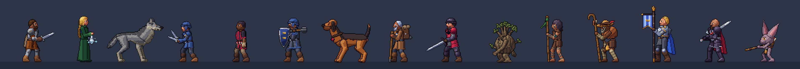
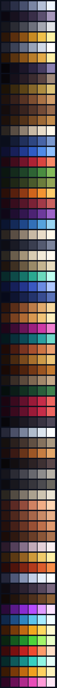
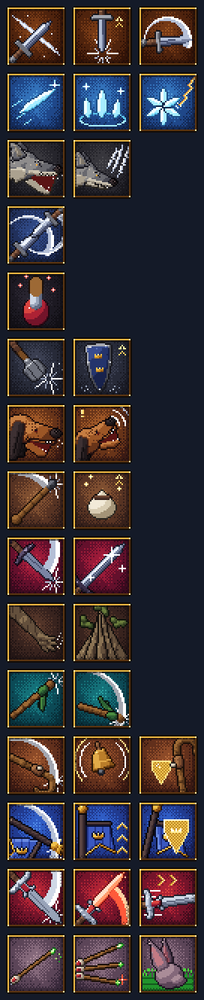
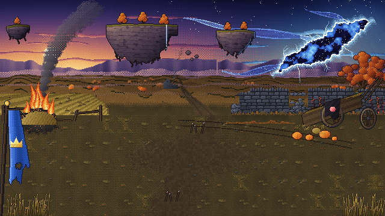
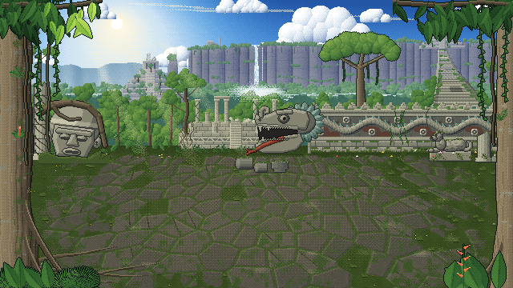
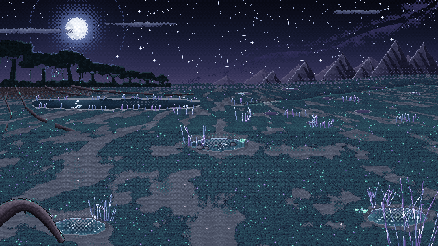
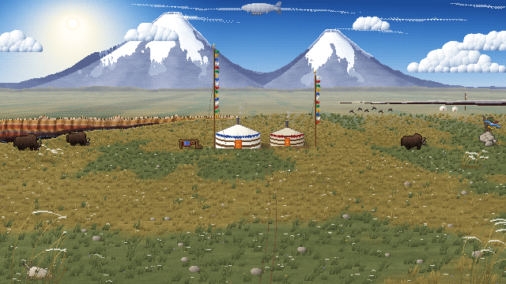
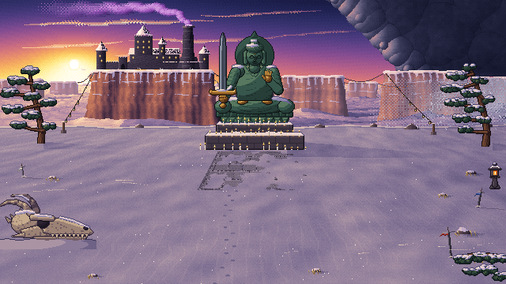
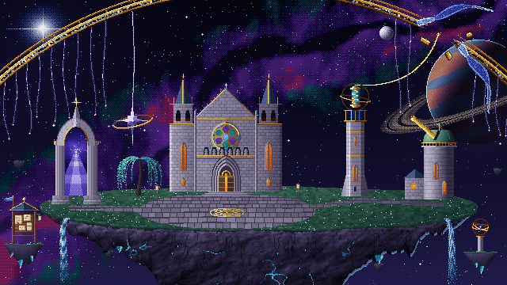

# Art Guiderails

This is the rulebook for every pixel in The Loom: Reliquary of Legends. Champions, effects, combat backgrounds, the world map, icons and UI parts are all **generated by code** (`tools/art/*`, run `npm run art`), and the generator enforces most of these rules automatically. `npm run audit` proves the rest. When you add art, follow the same rules so it sits next to the existing art without looking foreign.

**Direction:** high fantasy with a gothic arcane look. No science fiction, and no literal yarn or craft look: the Loom's threads, spools and patterns are arcane relics, never sewing things. The world is Jakub's ([DESIGN_DECISIONS.md](DESIGN_DECISIONS.md)): a realm broken by the fall of a celestial loom, floating islands, four factions with their standards. The two champions are drawn from his Starter Heroes record (DESIGN_DECISIONS.md 8); Zone 1's background follows his brief (DESIGN_DECISIONS.md 5.3a) and the world map his brief of the same day (5.4a), approved as built ("i love it"); he likes how the game looks as of 2026-10-11; new art is proposed with previews and approved before it is built.

Step-by-step recipes live in the project skills: [new champion](../.claude/skills/new-champion/SKILL.md) and [new combat background](../.claude/skills/new-combat-background/SKILL.md).

---

## 1. Grid and screen

| Rule | Value |
| --- | --- |
| Tile | **32 x 32 px** |
| Virtual screen | **640 x 360** (20 x 11.25 tiles) |
| Scaling | whole numbers only (x2 = 1280x720, x3 = 1920x1080); letterbox the rest |
| Sub-pixel positions | never: everything is drawn at integer coordinates in the 640x360 buffer |
| Rotation / scaling of art | only inside the 640x360 buffer, never on the upscaled image (no "mixels"); the only 2x art is the champion showcase (detail page, recruit ceremony), drawn at exactly 2x |
| Smooth gradients, anti-aliased shapes | never; gradients are posterized bands or 4x4 Bayer dithering (`ui.bands`, `ui.glow`, `rampDither`) |

All art is authored at 1x. The game renders into a 640x360 canvas and the browser upscales it with nearest-neighbour filtering.

## 2. Champions

### 2.1 Size and frame box

| Rule | Value |
| --- | --- |
| Body height (feet to top of head/helmet) | **66-80 px**; the audit fails below **64** or above **96** (idle frame 0) |
| Sprite height incl. weapon/horns/ears at rest | 68-90 px |
| Frame box | **208 x 160 px** for every champion and every frame |
| Pivot | **(104, 140)**: the point between the feet on the ground |
| Facing | champions are generated for **both** facings (R and L); sprites are never mirrored at runtime |
| Ground plane | `death` and `rise` frames are clipped 8 px below the feet line (`GROUND_CLIP`), so capes and sashes rest on the floor |

The frame box is generous so a glaive at full extension or a falling body never clips; the audit fails any frame that touches its edges. The build trims each frame and packs it into an atlas with the offset of the trimmed rect, so empty space costs nothing.

### 2.2 Proportions (about 5 heads tall)

| Part | Size |
| --- | --- |
| Head | 13-15 px tall (animal heads may run longer) |
| Neck to pelvis (torso) | 19.5-22.5 px |
| Legs (hip to ankle) | 31-34 px, slight knee bend at rest |
| Arms | upper 12-13.5, forearm 11-12.5, fist radius ~3 |
| Shoulder width in 3/4 view | 16-20 px including pauldrons |

Heroic stylisation: slightly large head and hands for readability, broad shoulders for warriors, slim silhouettes for casters and rogues.

A hunched champion keeps his height in the hump and the hat (the Jungle Herder: head-top 62.5 px, the hat and the crook to 78 px); a small one in what stands up from it (Big Ears: head-top 41 px, his ears to 64 px, the floor of the audit, since Jakub had them made a little smaller). A beast on four legs is drawn large enough to read: the Bloodhound is waist-high to the others, about 52 px to the withers and 69 px to the top of the head, its body some 55 px long; the Follower, a wolf, about 50 px to the withers and 71 px to the tips of his ears, longer in the leg and in the body; the Black Rhino, a great bull, 66 px to the top of his hump and some 110 px from his tail to the points of his tusks, the roster's largest (`footprint` 2.3). Each casts a longer shadow (`footprint` on its CharDef, 1.9 times a standing champion's) and stands its body a little behind the pivot, so hits and effects land at its chest.

### 2.3 View and layering

- **3/4 side view**, facing the enemy line. The near side of the body faces the camera.
- **Near limbs** are drawn in front of the torso. **Far limbs** are drawn behind it and shaded **one ramp step darker** (`shade: -1`).
- A shield or second weapon on the far arm sits between the torso and the near arm, so the near (weapon) arm always reads on top.
- Capes, manes, wings and quivers sit behind everything; tabards, aprons and kilts sit between the legs.
- Long robes and dresses use `robe()` (`parts.ts`): standing, the cloth hangs straight down with the hem just off the ground; once the wearer tips over (torso under 55 degrees: falling, lying dead) it follows the legs, so it never smears along the floor or leaves the feet behind. Anything else that hangs (sashes, tassels) hangs the same way as the robe.
- Feet stay on the floor: a kneeling back foot rests on its toes, heel up; only a weapon striking or planted may go below the feet line.

### 2.4 Silhouette and hue

Every champion must be recognisable from a solid black silhouette (the collection shows locked champions exactly that way). Each one owns a unique silhouette feature and a signature hue that the skill icons, card window and `color` in its data share:

| Champion | Silhouette feature | Signature hue |
| --- | --- | --- |
| Captain Gareth | broad layered steel pauldrons, a short faded cloak, a plain straight sword; a bare, bearded head | deep amber-brown coat + dull steel, a little darkened gold (`amber`, `iron`, `oldGold`, `faded`) |
| Rime Scholar | tall and slim, a floor-length dress, long hair down the back, a censer hanging from her hand with ice flakes round it | dark green + blonde, cold light in the censer (`pine`, `hairBlonde`, `glowIce`) |
| Skirmisher | slight and a little hunched, a rounded leather cap with a cheek guard, two short swords held forward; weaker-looking than the starters | blue leather with the Azure Crown's badge (`blueLeather`, `lapis`, `gold`), charcoal sleeves and trousers, brown boots; his cuts leave a plain white streak |
| Lineholder | the broadest of the three: a big dark-blue heater shield with two small gold crowns held before him, a flanged mace of dark iron resting on his shoulder, a blue leather helmet like the Skirmisher's with a nape guard | a charcoal quilted gambeson with blue stripes down the skirt, at the hems and round the sleeves (`charcoal`, `blueLeather`); the shield `indigo` with an `iron` rim and `gold` crowns; the mace `iron` and `wood`; brown boots. His swing leaves a plain grey-white streak |
| Quartermaster | a man of the road, a little stooped: a big pack on his back with a bedroll strapped along its top, a tall walking stick planted before him; grey hair and a short grey beard, bare-headed | a long coat of brown leather, belted, a pouch at the front (`leather`, `darkleather`), the Crown's blue badge with its gold crown on his chest (`lapis`, `gold`), charcoal trousers, dark boots; the stick `wood` with an `iron` ferrule. His rap leaves a plain grey-white streak, his Field Rations reach the others as warm light |
| Enforcer | a soldier in half armour holding a long bastard sword in both hands in a low guard, its point toward the enemy; a plain open-faced skullcap of dark iron (a closed barbute looked too heavy: Jakub had the helmet made less prominent so he looks weaker); the black hexagon on his chest | crimson: a brigandine of crimson cloth riveted over its plates, crimson lacquered spaulders and tassets (`crimson`, `crimsonPlate`), the hexagon `INK.black`; mail and dark iron beneath (`iron`, `darksteel`), charcoal trousers, dark boots; the sword `steel` with a blackened hilt. His cut leaves a plain white streak |
| Bloodhound | the first champion on four legs: a big black-and-tan bloodhound, waist-high to the others, his long ears hanging past the jaw, loose skin on the face and throat, a high curved tail | tan on the head, the chest and the legs, black over the back, the ears and the tail (`furTan`, `furBlack`); a black leather collar with the Dominion's hexagon, red, at the throat (`darkleather`, `crimsonPlate`). His bite lands as two rows of white teeth snapping shut, his bay as rings of sound |
| Dominion Medic | a slight field medic with empty hands and no weapon, a tunic in red and black stripes to mid-thigh, small red potions hanging from his belt, one raised high when he heals | the tunic black cloth with crimson stripes running down it and its skirt (`blackCloth`, `crimson`); the potions bright red under pale glass necks and light corks (`red`, `silver`, `wood`); sleeves to the elbow, forearms bandaged, brown trousers and boots. His heal rises as the potions' rose light |
| Follower | the second champion on four legs: a lean grey wolf, about as tall as the Bloodhound and longer in the leg, erect pointed ears, a shaggy ruff round the neck, a long bushy tail carried low; a little wild: ragged fur at the ruff, the belly and the legs, a nick in his near ear, a fang showing at the lip; no collar | grey over the body and the head, a darker saddle along the back and the top of the tail, cream on the throat, the cheeks, the belly and the legs (`furGrey`, `furSaddle`, `furCream`); amber eyes, a black nose (`furBlack`). His snap lands as two white jaws closing, his rend as three ragged tears |
| Walking Bush | a small weak ent grown from a bush, no head: a fat round body of woody stems on two stumpy root legs, branches standing up from his top and twigs from his sides with a few clusters of small leaves, two dark hollows for eyes in the bark, long arms of root ending in splayed root fingers | grey-brown bark in grooves and knots (`bark`), the leaves a bush's muted green (`moss`), never his affinity's; his icons and portrait on a darker brown (`darkleather`). His lash lands as a crack of wood and chips, his thicket as roots of his wood curling up round the feet (FXR `wood`) |
| Wild Speaker | a lean, barefoot man of the Court's semi-wild tribes with a long stick taller than he is, planted at his side, two green ribbons tied under its gnarled knob and stirring as it moves; bands, zigzags and chevrons of ink on his bare arms and legs, two strokes on his cheek; loose dark hair | tan skin (`skinTan`), a sleeveless tunic, fringed skirt and flap of dark leather (`darkleather`) laced and belted with lighter cord (`leather`), the ink a dark blue-green (`INK.tattoo`), the ribbons `green`, the stick `wood`, never his affinity's; his icons on `teal`, the ink's hue (green is his faction's). Markings on bare skin are 1 px lines of ink across the limb, in the limb's own render group. His thrust lands as a dull flash with the ring of the push, his Quell as a heavier flash with dust thrown out low |
| Jungle Herder | a hunchback, bent far forward under a great hump, his head thrust out under a wide, low cone of a straw hat; a crook taller than he is, its hook curled over at the top; a bronze bell hanging from his rope belt and swinging as he moves | a mantle of shaggy russet hide over the hump and the shoulders (`furRusset`, his signature; his icons on it), dark skin (`skinDeep`), a grizzled beard (`furCream`), the hat woven straw (`calabash`) with a macaw's red feather (`red`), a jerkin of charcoal cloth and a wrap of dark hide, forearms and shins wrapped (`bandage`); the crook `wood` with a leather binding, `bone` beads and a tuft of the hide; the bell `bronze` with an `iron` clapper. His blow lands as a dull flash under the curl of his hook; in Bellwether he drives the crook into the ground behind him and rings the bell out before him, rings of sound in the bell's bronze (FXR `amber`); his ward chimes the bell and draws the hook of a crook in that warm light over the ally it shields |
| Emissary Handlings | the tallest (head-top 71 px), upright, his chin up and his free hand on his hip; the Crown's standard on a pole taller than he is (the sprite tops out at 91 px), a gilded finial crowned with three points, the cloth hanging from a crossbar with a swallowtail hem and a gold fringe, rippling slowly; a long cloak to his calves | a breastplate, pauldrons, vambraces and gorget of polished `steel` edged in `gold` over mail (`iron`), charcoal trousers, tall `darkleather` boots; a bright-blue cloak (`blue`, his signature; his icons on it) with a gold crown at its clasp; fair hair combed back (`hairBlonde`), clean-shaven; the standard `lapis` with a `gold` crown and fringe on a pole of dark polished wood (`ebony`). The standard he carries is the Azure Crown's (DESIGN_DECISIONS.md 3.6): it belongs on a banner. His strike lands as a dull flash with a glint of gold; Rallying Standard raises the shape of the standard in light, gold and azure, behind each ally; Unbroken Flag sweeps a band of azure round the ally it shields and flashes a kite shield of gold |
| Red Cloak | a knight in full plate with a long scarlet cloak, the zweihander nearly as long as he is tall resting back over his near shoulder, a bald head | plate blackened as the Dominion's black (`darksteel`) and edged in `silver`; the cloak `red` (his signature; his icons on it), the Enforcer's crimson being darker and pinker; a weathered bald head (`skinTan`) with a brown goatee and moustache and a pale scar; the zweihander `silver` with a fuller and `gold` engraving, a ricasso wrapped in red leather between parrying lugs, a cross-guard with scrolled ends, red stones in the guard and the pommel (`glowRed`). Cleave leaves a white streak; in Crimson Blade the blade itself burns `glowRed` and its streak is crimson-hot (`ACCENT.redHot`, `red`): the skill's own glow, its name, never his affinity's; Onrush leaves the two streaks of a thrust, a war cry in rings and a gust past each ally it speeds |
| Big Ears | a small creature (head-top 41 px) whose two great ears, curving back along their length, carry him to 64 px; a big round head with the face of a beast (Jakub, 2026-10-17: "more animalistic ... without defined humanoid features and fangs"): a long pointed snout to a dark wet nose, whiskers, an amber eye with a slit of a pupil in a mask of darker fur, no lid and no smile, a ruff at the cheek, two fangs over the lip; a blowpipe longer than he is tall, held across him or at his lips | a dusky mauve hide (`duskHide`, his signature; his icons on it) with the inside of the ears pink (`earPink`) and folded, the eye `ACCENT.eyeAmber`; a loincloth of `darkleather`, a sash of `leather` with a quiver of cane (`calabash`) and white-and-red fletches (`bone`, `red`), a gourd of poison with a green stopper, a string of small teeth; the pipe `calabash` cane bound in dark hide with a `bone` mouthpiece. His darts fly with a green poisoned point and a white-and-red fletch and land in a small flash and drops of their poison (FXR `green`: the poison is what the skills do); when an ally falls the undergrowth stirs round his feet and his eye catches the light |
| Associate | a woman mage, tall and calm, in a full robe to her feet with wide sleeves; dark curls in round bunches to her shoulders; a staff of her height, its broader head three silver tines opening like a small crown, white motes circling it (the silhouette feature, with the curls) | the robe azure (`ice`) with white stripes down its front and side and up the bodice, white bands at the hem, cuffs and collar and a white cord (`whiteCloth`); over her shoulders a short cape of dark blue in a basket weave, fringed (`indigo`, the weave anchored to the cloth); warm brown skin (`skinTan`), the curls `hairDark` a shade down; the staff `ebony` shod in `silver`, a pale light at the tines' heart and the motes white with a pale-blue edge (`glowIce`, ACCENT `white`, `flake`); her icons on `lapis`. Her bolt is the motes flying as one and bursting white; her quickening the motes flaring round the raised staff and winding up round each ally; her answer to a blow the motes stinging the attacker, turning the green of the poison |
| Black Rhino | the third champion on four legs and the largest: a great black bull, low and massive, a shoulder hump under a shaggy mane, a long switch of a tail; his horns sawn to stumps capped in iron and two long tusks of ivory strapped to his muzzle, running forward under his nose and curving up before it (the silhouette feature, with the hump) | a black coat with a cool grey sheen (`bullBlack`), the mane's strands anchored to the shape they grow on; the tusks `bone` banded and tipped with `iron`, held by a band of `darkleather`; a broad grey muzzle (`charcoal`), cloven hooves of dark horn (`ebony`); the X his master painted in crude strokes of `red` with drips, across his back behind the hump; his icons on `crimson`. His gore lands as two thrusts of light and chips tossed up; his bellow as heavy rings of sound, with dust and a wall of dull iron light at each ally's feet; his hide's shield as a shell of dull light closing over him |
| Skeleton | a short skeleton, a little hunched, built bone by bone (a skull with its own jaw, a ribcage that shows its gaps, long bones with knobbed ends, paired bones in the forearms and shins); a short notched sword held low before him; strips of cloth wound round his neck, their frayed ends trailing (the silhouette feature, with the big skull); his bones fall into a heap when he dies (each bone's resting place in `HEAP`, the pose channel `heap`) | bone dulled grey with ash (`ashBone`), a pale light in the socket (`ashEye`); the strips `charcoal` and a plum silk (`plum`, his signature, behind his icons), a pennant of dark grey with a white bone at the front, the Reign's standard; the sword `iron` eaten by `rust`, its grip `darkleather`; his hack a dull pale streak, the rust in the effect's flakes |
| Rot Hulk | a big, fat hulk, as wide as he is tall (72 px): a great round body hunched forward, the belly hanging, a hump behind with a rusty meat hook stuck in it and a length of chain hanging (the silhouette feature, with the bulk); a small head sunk between the shoulders; heavy mismatched arms ending in great mitts; short stumpy legs; three flies circling his head; in his death he falls on his back, rot puffing off him | patches of dead flesh stitched together: rotted grey-green (`rotGreen`, his signature; his icons on it), a corpse-pale belly, head and near hand (`rotPale`), a bruised purple chest and forearms (`bruise`), a jaundiced hip and shin (`jaundice`), a square of `leather` on the hump; the seams crude black thread with cross-stitches, drawn as one pixel layer with no separation line (`line: 'none'`), iron staples with rust round them, drips of `bile` from the belly's cut; dirty `bandage` round the far forearm and the near shin; a milky eye (`ashEye`) and a dark one; the hook `iron` and `rust`; a rag of `charcoal` with a white bone round his near arm, the Reign's standard. His slam lands as a dull flash, gobbets of rot (FXR `bile`) and a puff of gas: matter, not light |
| Bellringer | the tallest of the roster (88 px), a long, thin skeleton built bone by bone (`tools/art/bones.ts`, shared with the Skeleton): a narrow ribcage of five ribs on a long spine, a neck of five vertebrae, long arms and legs; a gaunt skull with no lower jaw, its upper teeth hanging over nothing; a big bell held out before him like a lantern in place of his near hand (the silhouette feature, with his height); boots too wide for his bones; his bones fall into a long heap when he dies, the bell on its side beside it | bone dulled grey with ash (`ashBone`), a pale light in the socket (`ashEye`); the bell `gold`, with bands, a sound bow, a dark mouth and an `iron` clapper, hung from an `iron` collar riveted round his forearm, on which it swings (pose channels `bell`, `clap`); the boots `darkleather` with `leather` cuffs and an iron buckle; his icons on `indigo`. His toll opens rings of the bell's gold from the bell (`toll_rings`, played at the actor's head point and anchored onto the bell), closes a shell of the same gold round the ally it shields (`warning_toll`) and, when Last Peal wakes, round him (`last_peal`): additive light |
| Necromancer | a tall, gaunt man in a black robe to his feet, a little stooped, its hem ragged; a deep hood, its point hanging back over his nape and its rim forward over his brow, so of his face only the nose, the mouth and the chin show (the silhouette feature, with the book); a thick book held before him in his far hand, opened on his palm when he reads; small black motes circling his near hand on a tilted ring; he falls forward on his face when he dies, the book in his hand | the robe and hood `blackCloth`, a rope belt of `charcoal` with a toggle of `ashBone`; his face `skinPale` in the hood's shadow, a glint of `glowViolet` where an eye is, brighter while he reads; the book bound in `maroon` with `iron` corners and clasp, the Reign's white bone on its cover and yellowed pages (`bone`), a violet glyph glowing on each page as he reads; the motes black with a violet glint on their upper side; his icons on `violet`. His motes fly in a knot (`grave_bolt`) and burst dull (`grave_chill`); his verse is a dark smoke turning sickly (`plague_verse`, the `curse` ramp); his allies' haste is his motes spiralling up round them (`grave_haste`); Raise Dead opens a black sigil with violet glints where the ally fell, motes and pale wisps rising from it (`raise_dead`), and his pages flare (`tome_flare`, additive, on the book); the raised get up through their own death played backwards |
| Automated Soul | a tall, straight skeleton with no skull, built bone by bone (`tools/art/bones.ts`): the neck's last three vertebrae standing broken off in an empty gorget (the silhouette feature, with the longbow nearly as tall as he is); plate over the bones, the bones showing between the plates (the upper arms, the waist, the thighs and knees, the hands); a quiver at his back; he falls apart into a heap of plates and bones when he dies, the bow beside it | the plate `azurePlate` (azure enamel on steel, a metal, so it catches a highlight) trimmed and riveted with `gold`; the bones `ashBone`, a pale light (`ashEye`) at the gorget's mouth, flaring in victory, going out in death; the bow `wood` with a `darkleather` grip and `bone` horn tips, its string `string`; the quiver `darkleather` banded in `gold`, its fletchings and the arrows' `blue`; his icons on `azurePlate`. His arrows fly as `soul_arrow` (shaft, iron head, azure fletching; the volley's arrows fall as the same, turned along their path), bite in a dull flash and splinters (`arrow_strike`) and stand in the ground about the enemy's feet (`arrow_volley`); Pinning Shot's arrow trails the gorget's pale light (`pinning_arrow`) and lands in a ring of it (`pinning_strike`): matter, not light |
| Irving Wellbington | a dwarf's skeleton, short-legged and broad, the bones thick (his own `stoutLeg` and `stoutArm` on the shared bones of `tools/art/bones.ts`), a barrel of a ribcage; a big iron helmet with two great horns curving up from it, the near one forward, the far one back (the silhouette feature, with the shield); a braided beard on his jaw; the robust round shield before him on his far forearm, much bigger on Jakub's word, covering him from the knees to the chin; he falls apart into a heap when he dies, the skull rolling off in its helmet, the shield falling flat | the bones `ashBone`, a pale light in the socket (`ashEye`); the helmet `iron` with a lighter brow band and rivets, the horns `bone` ridged at the root and dark at the tip; the beard `furGrey` with an `iron` ring; the shield of `wood` planks in an `iron` rim with rivets and an `iron` boss, eight runes cut dark into the wood with the pale light (`ashEye`, `ashEyeDim`) in their cuts, waxing and waning, ablaze in victory; his icons on `charcoal`. His bash lands in a round dull flash and the ring of the rim (`shield_bash`), his slam in a dull streak, a heavy flash and dust (`bulwark_slam`); Old Grudge sets the runes ablaze (`grudge_runes`, additive, anchored onto the shield) |
| Grove Keeper | an old druid, tall and a little stooped: two branching antlers from his brow spreading like a crown, the near one sweeping back, the far one rising forward (the silhouette feature, with the staff); long grey hair down his back, a long grey beard; a long robe with wide sleeves; a gnarled staff taller than he is, its head three roots twisting round a seed of light | the robe `moss` worked with `oldGold` (a knotwork border at the hem, a band down the front, cuffs and collar); the antlers `bark` with pale `bone` tips; hair and beard `hairSilver` taken down a shade or two to grey; pale skin with the lines of age (`skinLight`), bare feet; a cord with a disc of `bone` and a feather; the staff `wood` with ivy (`green`), the seed `glowGreen`, leaves sprouting; his icons on `moss`. His thorns are the grove's wood stabbing up from the ground (FXR `wood`) and their sap drifts home to him in green; his rite whirls leaves and green light up round an ally, carrying its afflictions off as violet motes; his balm sprouts a sprig of green light at an ally's feet |
| Paladin | the tallest of the Crown's knights (75 px), young and bareheaded: silver plate from the gorget to the sabatons, wide pauldrons of three lames; blonde hair to the shoulders; a long cloak to the calves, three white crowns one under another down the part of it that shows behind him; the big shield in the Swiss shape before him on his far forearm (a straight top, straight sides, the lower half curving to a point); in his near hand a wide sword burning white-gold (the silhouette feature, with the shield); he falls on his face, the cloak over his back, the shield on the ground before him, the fire out | the plate `silver` edged in `gold` (the gorget, the fauld, the tassets, a rim under each lame of the pauldrons, a rosette on the near one); the cloak `indigo`, its crowns `whiteCloth`; the hair `hairBlonde`, the skin `skinLight`; the shield rimmed in `silver`, its field `lapis`, the double cross `whiteCloth`, gold studs; the grip `darkleather`, the guard and pommel `silver` capped with `gold`; the blade `glowGold` (its two brightest steps and a white heart), its flames drawn into every frame from `glowRed`, `glowAmber` and `glowGold` (7.4); his icons on `indigo`. His cut lands as a line of white-gold fire (`searing_cut`); Beacon blazes as a star of light at the blade's tip (`beacon_flare`, anchored onto it), streams its light over each enemy (`beacon_glare`) and raises the shape of his shield in gold light before each ally (`beacon_ward`); Trial by Fire roars up the levelled blade (`trial_blaze`, anchored onto it) and passes through each enemy as a flat arc of flame (`trial_flames`); all additive. The fire is the sword's own, the brief's, not his affinity |
| Chief Engineer CJ | the broadest man in the roster, his belly over his belt: a forge-master in a maroon coat under a great leather apron with the Dominion's hexagon on a medallion, a long brown beard; a loud orange helm (the silhouette and colour feature, his brief's hat); a belt of cogs, a spanner and pouches; a great two-handed hammer with a rune-lit band, drawn with arcs that jump off it each on its own slow cycle (the arcs stay above the floor) |
| Forest Gargoyle | a squatting gargoyle in weathered wood, wings folded with their wrists above his shoulders, a long tail; every spine, ear and fin a sharp green leaf (the silhouette feature). Keyed to his stillness: his idle is one pose with a single tick of the head on a loop of nearly six seconds, his moves stiff snaps, his run a glide |
| Dead Knight Amstron | a tall dead knight in full plate, deep crimson edged in scarlet, very wide pauldrons, a bare skull over the gorget; a tall tower shield with a white skull and the Reign's white bone (the silhouette feature), a long spear. His raised near arm keeps its elbow out behind (`bend: 1`), so it never crosses the skull |
| Strongman | broad and bare to the waist, a big grey boulder held in both hands before his chest (the silhouette feature), cropped dark hair, no helmet | bare skin (`skinLight`), a wide belt of bright blue with an iron buckle and a gold pin (`blue`, `iron`, `gold`), charcoal breeches, brown boots; the stone plain `iron` grey. His slam lands in Gareth's dull grey-white `heavy_blow`, his Gather Strength raises Brace's dust |
| Town Guard | a guard in light gear, a round wooden shield with an iron boss before him (the silhouette feature), a straight arming sword, straight blonde hair to the shoulders, no helmet; plainer than the Paladin, the other blonde of the Crown | a padded blue tabard with a small gold crown over a leather jerkin and sleeves (`blue`, `leather`, `gold`), dark bracers and belt, charcoal breeches, tall brown boots (`hairBlonde`, `wood`, `iron`, `steel`). His cut leaves a plain white streak; his shield lands in the Lineholder's dull `mace_blow` |

Both follow Jakub's record: Gareth wears field armour, not the Azure Crown's blue, and his cuts, once ember, are plain since 2026-10-12 (a white streak; light, dust and chips in the effects); the Rime Scholar does not wear the Sanguine Dominion's black and red, and the blue circle on the back of her dress is neither a faction nor an affinity mark (in the 3/4 view it shows as a narrow ellipse on the back of the bodice). Their heads, Gareth's beard, her face and the censer's shape are a first take the record leaves open. `color` in the data is the champion's own hue (Gareth's amber, the Rime Scholar's frost), and so is `iconBg` behind the skill icons and portraits. Within one faction no two champions share a hue family; across factions the material language should separate them. Champions in the field are not walking banners: the standards ([DESIGN_DECISIONS.md](DESIGN_DECISIONS.md) 3.6) belong on banners and sigils. Faction and affinity are independent: the Azure Crown captain is Ember, the Sanguine Dominion ice mage is Tide, on purpose. The Enforcer's crimson and the black hexagon on his chest are Jakub's brief (DESIGN_DECISIONS.md 15): the Sanguine Dominion's standard is a red hexagon on black, and he wears its shape in black on crimson.

**Affinity sets nothing in the art** (Jakub, 2026-10-11: "affinity should not dictate colors or elements or anything. these three affinity choices are very abstract"). Ember is not fire, Bloom is not leaves, Tide is not water: a champion's materials, hue, smears and effects come from who the champion is and what the skill does, and the affinity shows only where the interface marks it (the gem, STRONG HIT and WEAK HIT). The Lineholder is the first champion drawn under the rule: he is Tide, and his mace leaves a plain grey-white streak and lands in a dull flash and dust. Two pieces predated it, Gareth's ember cuts (his own record asked for his Ember "in what he does with the sword", DESIGN_DECISIONS.md 8) and the Skirmisher's leaf-green ones; on 2026-10-12 Jakub had both made plain and kept the interface's affinity marks. Jakub's briefs dress the Skirmisher and the Lineholder both in blue: they part by value (bright blue leather against charcoal and a dark-blue shield) and by silhouette.

## 3. Light

- **One key light for the whole game**: from the **top-left, slightly in front** (`LIGHT_DIR = normalize(-0.5, -0.65, 0.58)` in screen space).
- Every backdrop places its light source in the upper-left to justify it: the dawn sun rising between the far peaks of Zone 1. A second, colored light may live in the sky (Zone 1's rift lights the clouds and the islands' right flanks blue), never on the champions. Tiles are lit the same way (top/left edges bright, bottom/right edges dark), and so are carvings: in sunk relief the upper-left lip of a cut is in shadow and the lower-right wall catches the light.
- Because the light must stay top-left, sprites are **rendered** for both facings instead of mirrored. A mirrored sprite would light its right side.
- Runtime light only adds: additive glow pools around fires (`ZoneDef.glow`), a mood tint (`ZoneDef.tint`), unit shadows offset away from the light (`ZoneDef.shadow`: a low sun throws them longer and further right), and the light of a burning blade (the Paladin's sword, 7.4).

## 4. Palette

Every pixel comes from `tools/art/palette.ts`:

| Table | What | Used by |
| --- | --- | --- |
| `MAT` | 6-step material ramps `[outline, deep, shadow, base, light, highlight]` | champions, props drawn with the champion renderer, menu glyphs |
| `ACCENT`, `INK` | single colors for decals, smears, eyes, glyph details | champions, icons |
| `FXR` | 5-step effect ramps, dark edge to white-hot core | combat effects |
| `UIR` | interface ramps: gold, navy, steel, stone, rarity and affinity ramps | UI parts, card frames, gems |

Zones declare their own ramps at the top of their module (sky, stone, sand...), because a background is one painting with its own light; the audit holds them to a color budget instead.

| Index | Use |
| --- | --- |
| outline | 1px silhouette outline and separation lines; never pure black |
| deep | occlusion and far-side core shadow |
| shadow | form shadow |
| base | the local color, what the material "is" |
| light | planes facing the key light |
| highlight | specular sparkle on metal, brightest accents; use sparingly |

**Hue shifting**: shadows move toward blue/violet, highlights toward warm yellow. Never darken a color by just lowering its brightness.

**Champion modules contain no color literals.** `npm run audit` fails a `hex('#...')` or `'#rrggbb'` in `tools/art/champions/*.ts` and any atlas pixel that is not in `MAT`, `ACCENT` or `INK`. Need a new material? Add a 6-step ramp to `MAT` (keep the hue shifting).

Material kinds decide how light quantizes into the ramp (`BANDS` in `palette.ts`): `matte, cloth, skin, hair, fur, metal, glow`. Metal gets a single-pixel specular highlight; glow materials are unlit and get a colored halo instead of a dark outline.

## 5. Shading

- **Cel bands, no gradients** on characters: the renderer computes a normal per pixel (tubes for limbs, domes for heads, bevels for plates and cloth), takes `n . L`, and snaps it to the material's ramp.
- **No dithering on characters.** Dithering (4x4 Bayer) is for the sky, backdrops, sand and snow, light pools, effects and icon backgrounds.
- **No orphan pixels**: a shade pixel with no same-shade neighbour inside its shape adopts the majority shade (cleanup pass). Deliberate single-pixel highlights are exempt.
- Cloth folds, wraps, bark and scale armour come from per-material texture functions (`tex`), never noise.
- A texture keyed to screen pixels stays put while the shape moves, so on a shape that breathes or sways it swims. Key it to the shape instead: the `Hit` a texture receives carries the shape's own coordinates (`u` along a `cyl` axis, `v` across it; offsets from a `dome`'s centre), as the Black Rhino's coat and mane and the Associate's weave do. Curls read as bunches: small round locks, each lit on its own (the Associate).

## 6. Outlines

- **1px outline around the silhouette**, colored with the outline entry of the material it touches (colored, never black).
- **Separation lines** where one form overlaps another: the pixels of the form behind get the outline color (`strong`) or two ramp steps darker (`soft`, for plate layers and folds).
- Joined parts of the same limb are one group and never get a line between them.
- Separate objects that cross (two swords, a weapon over a shield) each take a group of their own, or they melt together where they overlap; the crossed swords of `mi_campaign` are `sword1` and `sword2`, like the Skirmisher's.
- Glowing parts (crystals, runes, eyes, gems) get a halo in their own deep color instead of a dark outline.

## 7. Animation

### 7.1 Required set per champion

| Animation | Frames | Timing | Notes |
| --- | --- | --- | --- |
| `idle` | 6-8 | 130-160 ms | whole-pixel breathing (1px), cloth/hair sway; desynchronised per unit |
| `run` | 8 | 65-85 ms | used to approach a target and to return; cape and hair stream back |
| `attack1` | 6-10 | see below | A1 |
| `attack2` / `skill` | 7-11 | | A2 (`skill` = in-place cast, also the victory pose) |
| `attack3` | 8-12 | | A3 |
| `hurt` | 3 | 90-110 ms | lean back, head snaps |
| `death` | 6 | 110-220 ms, last frame 600 ms | kneel, fall, lie still; the game fades it out |
| `rise` | 6 | | only for champions with Undying: the death played backwards, then stand |
| `victory` | 5-8 | | optional: played by the winners at the end of a battle (Gareth's salute, the Rime Scholar's lifted censer); without it the winners play `skill` |

The content tests fail when an animation a skill names is missing, and when the animation's number of hit frames differs from the skill's `hits`.

### 7.2 Attack structure

1. **Anticipation** (1-2 frames, the longest, 130-220 ms): wind up away from the target.
2. **Strike** (1 frame, 50-70 ms): the weapon has already travelled, a **smear** shows the path. This is the **hit frame**.
3. **Follow-through** (1-2 frames, 90-260 ms): overshoot, hold the pose so the impact reads.
4. **Recovery** (2 frames): blend back to idle.

| Event | Meaning |
| --- | --- |
| hit frame (`hit: true`) | damage numbers, hurt reactions and impact effects fire here (one per `hits` entry of the skill) |
| `shoot` | a projectile leaves the bow or staff (and Arrow Rain's volley) |
| `jump` | leap take-off; the game moves the champion in an arc that lands exactly on the next hit frame |
| `cast` | spell flash moment; plays the skill's `actorFx` at the head (a howl, a flare) |
| `turn` pose channel | flips the facing for one frame (spins, Mirage Assault) |

### 7.3 Smears

Weapon smears are crescents drawn between the previous and current weapon angle: **thick at the leading edge, tapering to a hairline at the trailing end**, white rim outside, the champion's tint inside (`smearSteel`, `smearGold`, `smearViolet`... in `ACCENT`), taken from the champion's own look or weapon, never from its affinity (2.4): every weapon of the Azure Crown leaves white and the light of its own steel or iron, and so does the Enforcer's sword. They sit behind the body and never exceed ~200 degrees of travel.

### 7.4 Fire on a weapon

A weapon that burns (the Paladin's sword) burns in every frame of every animation, drawn into the sprite:

- Tongues rise from both edges of the blade **up the screen, whichever way the blade points**, and lean away from its travel since the last frame (`info.prev`), longer the faster it moves, so a swing trails fire.
- Each tongue flickers at its own pace, in **whole cycles over a looping animation** (idle, run), so the loop stays seamless; outside the loops they run on at an even pace.
- The fire is light: no outline, no separation lines, and it sits **behind the blade**, so the blade stays the brightest thing. A few embers drift up off it.
- How hot it burns is a pose channel (`fire`: 1 at rest, up to 2 when it roars, 0 when it goes out as he dies).
- The atlas records where the blade burns in each frame (`CharDef.glow`, `glow` in the champion's JSON: its base and tip and the heat), and the game adds soft bands of warm light along it in battle and on every menu that shows the champion, and throws embers off it in battle (`drawBladeGlow` in `src/game/view/unit.ts`, `throwEmbers` in `scene.ts`).

## 8. Effects (`tools/art/fx/`)

- `kit.ts` holds the shared vocabulary: crescents, cuts, bursts, sparks, rings, shards, flames, motes, glyph stamps, crossed blades. `common.ts` holds the original effects, `sunscar.ts` the desert ones, `nyota.ts` the hard light, sound and starfire of the plateau, `azure_crown.ts` the Azure Crown's (Captain Gareth's cut, the heavy blow of Iron Blow and the flat arc of Wide Sweep; the Skirmisher's two cuts; the Lineholder's mace blow and the dust of Brace; the Quartermaster's stick rap and the warm light of Field Rations) and `sanguine_dominion.ts` the Rime Scholar's (the pale shard and its frost bloom, Rimebind's binding rime, the frost cast circle, Cold Rebuke's burst of ice and its cold flare) the Enforcer's long cut, the Bloodhound's bite and bay (anchored at his mouth), and the Dominion Medic's tonic, and `court_of_root.ts` the Court of Root's (the Follower's snap and rend, the Walking Bush's root lash and thicket, the Wild Speaker's staff blow and quell, the Jungle Herder's crook strike, the bell's rings of Bellwether, the chime and the hook of light of Herder's Ward, Big Ears' dart, its strike and the undergrowth and the glint of his passive); `azure_crown.ts` also holds Emissary Handlings' banner strike, the standard of light of Rallying Standard and the azure band and gold shield of Unbroken Flag, and `sanguine_dominion.ts` Red Cloak's cleave, crimson cut, onrush, war cry and gust; `azure_crown.ts` also holds the Associate's motes (the bolt, its burst, the flare, the quickening, the bitter motes), `sanguine_dominion.ts` the Black Rhino's gore, war bellow, the stand of each ally and thick hide, and `court_of_root.ts` the Grove Keeper's thornburst, sap mote, cleansing rite and balm; `index.ts` merges them. New champions add their effects to the module of their faction.
- An effect shows what the skill does (a cut, a blow, a shield set), never the champion's affinity (2.4).
- Every effect uses `FXR` ramps ending in a near-white core.
- 40-80 ms per frame; impacts are 5-8 frames, set pieces up to 12 (the sarcophagus), looping cues (stun stars, cast circles, projectiles) loop.
- Each effect has an **anchor**: chest-level impacts are centered (`ay 0.5`), ground effects are anchored at the feet (`ay 0.9-1.0`); the battle places any effect with `ay > 0.8` on the target's feet automatically.
- Nothing is cut off by its box. An effect that grows past it (rings at the feet, spikes, bursts, sparks) gets room with `pad: [top, right, bottom, left]`: the drawing keeps its own coordinates, and the built box and anchor include the room, so the effect lands on the same spot. `npm run audit` fails any frame that runs into its box edge, and padding that would move a ground effect's anchor to 0.8 or below.
- Beams from the sky (holy light, sunfire) dissolve toward the top with dithering instead of ending in a straight line.
- Draw layers: `ground` (cast circles, cracks, shockwaves), `world` (depth-sorted with units: ice spikes), `top` (slashes, beams, pillars, numbers).
- Additive blending only for light (holy beams, heal sparkles, hit stars, fire bursts, the revive helix). Solid effects (ice, sand, smoke, the sarcophagus) are drawn normally.
- Hit effects are designed facing right; the battle flips them when the attacker faces left.

## 9. UI (`tools/art/ui/`)

| Element | Spec |
| --- | --- |
| Font | one hand-drawn pixel family (`tools/art/font.ts`) in four faces. `regular`: caps 7 px, x-height 5, descenders 2 (cell 9 px). `bold`: the same letters redrawn with 2 px stems, so the counters of m, w, M and W stay open. `display`: the title face, caps 13 px drawn at full size (cell 18 px, two body cells), capitals only, for titles, champion names in headers and ceremonies, cooldowns and critical hits. `micro`: 3x5 digits in the same rounded shapes, for the turn counters on 12 px status icons. Text is never scaled up from the body faces; only the display face is drawn at 2x (battle titles, results). Titles take a two-tone fill (lower half of the capitals) |
| Logo | approved 2026-10-08: a gothic rose window (six gold lobes in a ring, each holding an arcane jewel as the Weaver Matrix holds six spools, a seventh at the centre) before THE LOOM. Letters and tracery are strokes rasterized and shaded as cast gold (lit bevel top-left, dark bevel bottom-right, hard face bands), with a drop shadow; 271 x 58 px. The subtitle RELIQUARY OF LEGENDS is text in the `display` face between two dividers, drawn by the main menu |
| Matrix rose | **144 x 144** (`tools/art/ui/matrix.ts`): the outer ring and the fixed slots in cast gold, the choice slots rimmed in arcane metal; the fixed triangle as gold rods, the choice triangle as a thread of arcane light; dark dithered wells for six slots and the centre. Shares `castMetal` with the logo |
| Spool | **18 x 18**: a crystal capsule holding a spiral thread of light, a relic and never a reel of yarn. Cap metal by grade: ebony (Ashen), silver, gold (Gilded); the thread's ramp by pattern, one hue each (a stand-in palette): Pulse orange-gold, Sunder red, Ward steel blue, Vigor green, Needle gold, Apex magenta, Focus violet, Tranquility turquoise; the glass glows in the thread's colour so the spool reads at 1x |
| Skill icon | **40 x 40**, 2px gold bevel frame, radial dithered background in the champion's `iconBg` ramp, glyph rendered with the champion renderer (an icon's glaive is the glaive the champion holds) |
| Status icon | **12 x 12**, buff = blue rim, debuff = red rim, 8x8 symbol, optional up/down badge or a second strike-through glyph (Heal Block) |
| Card frames | 24x24 nine-slice per rarity (`UIR.rarity`, base color = the rarity color in `meta.ts`), transparent center; `card_locked` in stone |
| Gems | 11x11, one cut per affinity so color is never the only cue: Ember diamond (red), Bloom leaf (green), Tide round with a glint (blue) |
| Emblems, roles | 15x15 faction medallions in a gold rim, after the standards (DESIGN_DECISIONS.md 3.6): the Azure Crown a gold crown on blue, the Sanguine Dominion a red hexagon on black, the Court of Root a brown paw on green (a 9x9 charge: four toe pads over the main pad, lit on their upper-left edges; a talon until Jakub asked for a paw, 2026-10-13), the Ashveil Reign a white bone across a dark grey. 9x9 role glyphs: Tank, Damage, Support |
| Panels, buttons | nine-slices: panels 6 px corners, big buttons 8 px, HUD buttons 4 px |

Screen layouts and interaction rules: [UI_GUIDE.md](UI_GUIDE.md).

## 10. Combat backgrounds (`tools/art/zones/`)

A zone is one module exporting a `ZoneArt` (contract in `zones/shared.ts`):

| Part | Rule |
| --- | --- |
| Backdrop | 640 x 200 painting: sky with the key light in the upper-left, then distant land; `horizon` marks where land meets sky (heat haze, mist) |
| Rows | 0-1 sky, **2-5 the back wall**, **6-11 the floor** where units stand |
| Tiles | 32 x 32, **seamless by construction**: stones put their joints on the right and bottom edges and their bevel light on the top and left |
| Openings | gates, arches and colonnade gaps are transparent so the backdrop shows through; put something worth seeing behind them |
| Props | sprites with a `PropKind`: `static`, `loop` (cycles frames), `pulse` (frame 1 breathes over frame 0, one breath every `ms`), optional `fire` (embers and a light pool, plus the shared `flame` on top unless `flame: false` when the prop paints its own fire), optional `bob` (drifts a pixel or two up and down: floating islands), optional `drift` (drifts sideways across the screen at `speed` px a second and comes round again: clouds; a negative speed drifts west: Zone 4's zeppelin), optional `roam` (walks to and fro along its row, `span` px out at `speed` px a second, grazing `pause` ms at each end; the first `walk` frames are its walk cycle, the rest its grazing; it faces the way it walks: Zone 4's yak) |
| Layers | `far` (behind the tiles: sky pieces and distant scenery, the rift, islands, a tree behind the wall), `back` (on the wall), `floor` (under units), `fg` (in front of everything, keep to the screen edges). A `floor` prop is drawn after every `back` prop, so it must not overlap one it should sit under |
| Sparks | optional `sparks` emitters (`SparkEmitter`): lines of the scene that shed sparks drifting off and twinkling out, drawn with the far layer (the lips of Zone 1's rift); `every`, `speed` and `life` set how many, how fast and how long: something gigantic sheds slow sparks that linger |
| Value | the floor is mid value and low contrast so outlined champions always pop; reserve the brightest values for sky and sparkle |
| Budget | backdrop at most 220 colors, tileset at most 160 (`npm run audit`) |

Runtime behaviour lives in `src/game/data/zones.ts` (`ZoneDef`): ambience (`snow`, `sand`, `motes`: drifting star-dust plus shooting stars behind the architecture, `leaves`: autumn leaves tumbling across in the wind, `pollen`: pollen drifting slowly through the sunlight, `spores`: glowing dust-motes of bioluminescent flora drifting and rising in soft halos that breathe and turn slowly through four pearl tints, the far ones behind the champions and the near ones in front, `seeds`: feather-grass seeds sailing across on the wind from the left as short pale streaks, a few close to the camera and faster, or `flurries`: snowflakes blown in from the right ahead of a storm, melting away as they cross so they thin out toward the left, a few close to the camera), `butterflies` (the spots butterflies flutter about, one each, wings beating and now and then gliding), glow color of fires, ember colors (`embers`, default firelight), shadow offset and stretch, mood tint, birds (any flying sprite named `bird`: vultures, sky-skiffs, Zone 1's ravens; `birdsAt`: the spots they circle, the birds shared out among them in turn; the kind's `ms` for the wingbeat), heat haze, and `flash`: now and then the sky lights up for a moment in a strange colour, spreading from a point (Zone 1's rift; `?skyflash=1` brings it every few seconds), and `shootingStars`: now and then, rarely, a shooting star across the sky (Zone 3, every 14-32 s). `homeZone()` picks a faction's background for its Academy demos and champion dioramas.

| Fracture Reach (`zone1.ts`) | Verdant Grove (`zone2.ts`) |
| --- | --- |
|  |  |
| **Moonlit Basin (`zone3.ts`)** | **Earth Scars (`zone4.ts`)** |
|  |  |
| **Snowy Mesa (`zone5.ts`)** | |
|  | |

Zone 1, redesigned on Jakub's brief of 2026-10-11 (DESIGN_DECISIONS.md 5.3a: less symmetrical, more broken, a cartwheel on the right, a field and something burning on the left, bulky islands, a rift in the cosmos with blue and white sparks and cosmic fabric waving from it, autumn, dawn): the morning after a raid on the island's farm. On the left a stubble field with its sheaves behind a broken fence, a haystack burning, its smoke leaning east, and the Azure Crown's standard torn and leaning in the foreground. On the right what is left of a dry-stone wall (a broken end, a breach, autumn ivy), an autumn tree behind it, and a hay cart tipped over with a wheel off, pumpkins spilled and the Sanguine Dominion's standard snapped across it. Between them the road runs out to a farm burnt in the night. Above, the dawn sun rising between lilac peaks in a sea of mist, bulky floating islands of strata and crags with autumn trees and a waterfall, bobbing; on the right the rift, a jagged tear of deep space with a blue nebula and white-hot lips, cracks running into the sky, pulsing and shedding sparks, three veils of star-threaded cosmic fabric waving out of it. Autumn leaves tumble across the arena. Everything the brief did not name (the raid, the fence, the cart's load, the burnt farm, the arrows, the tree) is a first take. On his brief of 2026-10-12: a broken windmill in the middle field beside the burnt farm; the fire calmer, each tongue at its own pace; the rift slower, as something gigantic; now and then a flash of strange light across the sky; and more details: crows wheeling over the farm and two on the wall, stooks, fence posts along the road, puddles in its ruts. On his next message: the flash every 10-25 s; things round the mill (a millstone, sacks, a barrel, charred boards, a barrow); distant rocks drifting in the left sky; tools in the fields (a scythe on the fence, a pitchfork, a rake, a plough) and toward the centre (a well, barrels, a handcart, a spade, a hoe); more ravens on the left, wheeling, on the fallen standard and pecking by the fence. Every loop closes on its first frame: a fire's tongues and a veil's twist run whole cycles per loop.

Zone 2, painted on Jakub's brief of 2026-10-12 (DESIGN_DECISIONS.md 5.4b: an overgrown place full of statues and columns, old temples on a jungle table mountain, many trees in the foreground, a sunlit day, butterflies, birds and clouds, architecture like the Maya's but only similar, serpents carved on a wall on the right in front of the stairs to the table mountain, lightly animated): a jungle ruin at midday. The sun high in the upper left breaks through the canopy in slow beams (`back` props that `pulse`). Far off, the table mountain is drawn as a row of rock columns, each lit on its western side, under a castellated brow; a waterfall falls from it (a `far` loop over the backdrop's static water, its mist a `pulse`). On the brow stand stepped pyramids with pierced roof combs, and the great stair climbs to the main one, a trapezoid in perspective drawn with sunlit treads and shaded risers, hazier toward the top. The jungle is heaped puffs (`drawPuffs`), each shaded as a ball in the sun, with dark seams where they meet. The colonnade on its terrace is painted into the backdrop. The serpent wall's tiles alternate the two half-waves of one feathered serpent in relief (64 px period, `relief()`), under stepped merlons that let the stair show through. The statues (the serpent's head in its collar of feathers, the colossal head, the jaguar) are drawn with the champion renderer from stone materials declared in the module, then mossed. The court is a floor prop of irregular flagstones in perspective (a Voronoi of stones bigger toward the camera), each lit along its upper-left edge, the joints grassy, frayed toward the corners. Two great trunks, the canopy's leaves and lianas frame the edges (`fg`, all anchored at the top so the preview and the game draw them in the same order). High clouds `drift`, macaws circle (`birds`), and butterflies and `pollen` drift in the light. Its ten placeholder stages (2-1 to 2-10, 2026-10-13) are fought on it, and `&zone=zone2` still puts any stage on it.

Zone 3, the Moonlit Basin, named and described by Jakub on 2026-10-17 (DESIGN_DECISIONS.md 5.6: beyond the trailing roots of the Verdant Grove the soil pales into silver sand, a low-lying basin floor carpeted in glowing twilight-moss, pale glass-like reeds swaying without a breeze in pale blue and violet, the ground swelling toward the sharp silhouette of the eastern hills, dust-motes of bioluminescent flora drifting in pearlescent halos over quiet, crystal-clear tide-pools; "a new dynamic zone"): night, the full moon the key light in the upper left in a soft glow (a dithered core of `HALO` over a wide brightening of the sky) and a faint ring of ice, stars, a faint milky band, thin clouds drifting past the moon. The eastern hills are crags drawn back to front (`FAR_CRAGS`, `NEAR_CRAGS`): two flanks from a peak, jagged in short straight runs, lit left of a ridge that falls from the peak, dark beyond it, a silver rim on the lit edge against the sky, a mist at their foot. The grove's last trees on the left are one silhouette mask (trunks with buttresses, umbrella crowns of leaf clumps, lianas), its edge pixels that face the moon rimmed with its light, so they read backlit. The basin's far floor and the arena's moss share one perspective (`world()`: a row's scale grows from a vanishing line toward the camera, x is measured from the screen's middle), so the far basin runs on into the near floor and no texture shears into streaks, which a scale changing per row without that centre does. The moss is cellular clumps (`cells()`), each a dome lit on its upper left with dark seams, a few tips glowing; the sand tiles carry tidal ripples on a 32 px period. The tide-pools are loops of 24 frames: a clear bed of pale shallows and pebbles, the sky's band along the far shore, glints shimmering, a ring spreading over the first third of the loop and then still water. The glass reeds are stems that sway about their roots on their own phases, a glint running up each stem once a loop; translucent pixels make them glassy. Pulses do the breathing (twinkling stars, the moss's glow, the lumen-bells, the halos over the pools; an empty frame 0 costs one pixel), the clouds `drift`, and the ambience is `spores`, with rare `shootingStars`. Its ten placeholder stages (3-1 to 3-10) are fought on it.

Zone 4, Earth Scars, named and described by Jakub on 2026-10-18 (DESIGN_DECISIONS.md 5.7: the easternmost place, a steppe by day, yurts with small colourful flags like a vertical chain on very long poles, a few wild yaks roaming nearby, slightly on the left the silhouette of a very big mountain with a snowy peak and on its right a twin a bit lower, a distant zeppelin in the sky, two deep ravines on the map, some parts moving): noon, the sun high in the upper left over a deep blue sky (`SKYSUN`, the sky ramp running into white-gold), cirrus and cumulus. The two mountains are a smooth minimum of two concave profiles (`mountTop`, `massifTop`: the saddle rises where the flanks meet), shaded as cones (`coneAt`: at a height each is a circle as wide as its silhouette, and where both cover a pixel the one that bulges nearer is seen, so they meet along a crease rather than a vertical seam); ribs fan from each summit, the snow line runs down the gullies between them and thins out in streaks along the fall line, the haze lifts the lower slopes. The far steppe and the arena share one perspective (`world()`, as in Zone 3); the haze is three hazed copies of the grass ramps (`hazed()`), each dithered into the next by distance, which a dither between two unlike ramps turns into a checkerboard. Grass tufts are placed on a grid in world space, sized by their row and drawn back to front (`tufts()`), so they grow as they come near. The ravine's far wall faces us with the sun beyond it: strata level along an unnotched lip, darker with depth, fluted, cut by rain gullies, its lip lit; where the gap is wide its floor shows, dark, with a thread of water. The yurts are cylinders seen a little from above under low cones (`yurt()`); the flag poles are loops whose flags each ripple on their own phase down the chain (`flagPole()`); the yaks are drawn from a pose (`yak()`: masses for the barrel, rump and hump, a skirt of hair to the hem, legs from hoof offsets) into grazing and walking frames, and one of them `roam`s. Gusts are loops of sparse lit blades crossing a box and fading (`gust()`), masked to the grass on the backdrop; feather grass sways like Zone 3's reeds, a silky awn trailing from each stem. The zeppelin `drift`s west with a negative speed, its propellers turning; birds are eagles; the ambience is `seeds`. Its ten placeholder stages (4-1 to 4-10) are fought on it.

Zone 5, the Snowy Mesa, named and described by Jakub on 2026-10-19 (DESIGN_DECISIONS.md 5.8: the top of a snow-capped tabletop mountain, many more all round, all connected with many candles, before sunset, a snowstorm approaching from the right corner, a castle on the left mesa with a huge chimney breathing purple dust and particles, a few trees and a big arbiter statue like a Buddha holding a big sword; mid-build the sword moved in front of the hand that holds it, and a dragon's bone added at the front left): the light before sunset, the sun low in the upper left, set in from the corner so the runtime's vignette, darkest there, does not dim its glow. The sea of cloud far below is a height field rendered column by column in true perspective from near to far (`sea()`: a world point at depth Z shows at y = VY + (1 - E) F / Z, so nearer billows hide further ones and each shows a lit top over a shaded flank); it keeps its depth per pixel (`seaZ`), and a mesa's pixel is hidden wherever a billow nearer than the mesa covers it, so the clouds take the mesas' feet; the clouds heap against the mesas and their long shadows lie on them (`seaShadow`). The mesas are drawn far to near from screen boxes (`mesa()`): broad buttresses and fine fluting shaded by the low sun (`sunOn`), soft strata, a snow cap with its cornice's shadow and a few icicles, snow on broken ledges and down the gullies, a top seen from above for those below the eye; the haze takes three hazed copies of the rock and snow ramps. The storm is billows bulging over one another (`stormAt`: the one that bulges nearest at a pixel is seen), a fold of shade where one passes behind another, the front's faces lit rose, solid behind; its veils are ordered-dither streaks, and a far loop drops snow through them. The castle and its huge chimney are painted into the backdrop; the purple dust is a far loop of puffs that rise out of the chimney and stream away left on the wind, each on its own wander, and its motes are a `sparks` emitter along it. The arbiter is drawn with the champion renderer (`arbiter()`: weathered bronze `M_VERD`, his hands, hilt and soles worn to `M_BRONZE`, the blade `M_STEEL`, granite steps, snow primitives on his head, shoulders, lap and guard), the sword in front of the arm that holds it, his robe's folds and curls as textures; the candles on his plinth are a loop in his own box, each flame on a whole number of cycles a loop (`drawCandle`). The pines are pads of needle lumps heaped and capped with snow (`needlePad`), swaying more the higher they grow. The cables from our rim, their posts and swinging lanterns are back loops; the far cables' candles a far loop over the backdrop's lantern pixels; the castle's windows a pulse. The arena shares the backdrop's perspective (`world()`): snow drifts lit on their flanks toward the sun, cooler under the storm, the long shadows of the statue, its blade and the pines (`shadowK`), the terrace's flagstones laid in world space with drifts over them, footprints, rocks with frozen grass; the challengers' swords with their ribbons, the stone lantern and the dragon's skull (the champion renderer again, running off the left edge) are floor props, a bough the near corner's. The ambience is `flurries`; the storm's lightning is the zone's `flash`; choughs are its birds. Its ten placeholder stages (5-1 to 5-10) are fought on it.

Floor tiles repeat across the arena, so a crack or a stain painted into a common variant repeats everywhere: keep damage to one rarely placed variant, and keep organic floors seamless by sharing one base field across variants and fading each variant's own detail in away from the tile border (`grass()` in `zone1.ts`). Large ground features (a worn path, a trampled patch) are `floor` props, not tiles.

## 10a. The main menu's sanctum (`tools/art/sanctum.ts`)

The main menu is not a zone: it has a diorama of its own (Jakub, 2026-10-24: "new and static, designed just for main menu", "very epic", "celestial or planetar"). `npm run art -- menu` writes `public/assets/menu/` (`sky.png`, the whole static sky; `scene.png`, every sprite of the island; `menu.json`, where they go and how they move) and the preview `docs/images/menu_sanctum.png`; `src/game/view/sanctum.ts` draws it.

The sky: near-black space deepening to indigo toward the abyss; a nebula band rising to the right, warped by slow noise so it billows, violet in its core, teal toward its edges and a breath of rose, all dithered into one another and kept low in value, dark lanes winding along it; stars crowding along it; the pole star in the upper left, the key light, a halo and four spikes. The giant planet is a crescent lit from beyond it (the light behind it, so most of it lies in night, the night side faintly lit by its rings), warm and cool bands of uneven width bent by turbulence, a storm, the rings' shadow on the globe, its rings split so the far half passes behind the globe. The Loom's rim is an ellipse whose crown stands above the screen, so it frames the sky from the corners and leaves the title clear: a band of plates of old gold with a channel of runes in arcane light, its outer lip lit by the pole star, a thin rail outward joined by struts, studs of light; it is broken on the right (`BREAK`), its fragments bobbing near the gap, and two veils of its cloth (Zone 1's veil technique and ramp, so the rift and the Loom read as one world) stream from the broken ends on a slow loop. Its warp hangs loose: threads of starlight in a slow S, a bead of light at each end, a few snapped and curling. The golden thread climbs from the Weaver's Spire's spool to the break in a curve that dips under the title.

The island: one sprite in screen space. Its top in grass with glowing flowers, a plaza of flagstones and paths, a gold medallion of the Loom's rose; under its lip a cliff of strata lit from the left, moss hanging, then the great inverted crag of its underside, faceted (a noise's slope stepped into planes), cracked, veins of crystal surfacing here and there, clusters of crystal jutting, roots hanging, the planet's light along the edges that face down and right; waterfalls off both ends that arc over the lip and fray into spray. Each place is its own sprite, so its pixels are what the pointer hits and an outline can be made from its silhouette (`outlineOf`: a bright ring just outside it, a dimmer one beyond): the Starbridge Gate (fluted pillars, voussoirs, a jewelled keystone, a gold star; its portal a loop of violet depths with stars streaming in and a road of light running into them), the Reliquary (`ashlar()` courses, belfries and slate spires, a gable with crockets, the rose window as the logo's rose in stained glass, a gallery of figures, a portal of archivolts round a door ajar on candlelight), the Weaver's Spire (an octagon of three lit faces, a gallery of gold columns, its spool a loop: a crystal spool, its thread spiralling, an armillary of two rings turning round it), the Observatory (a lit cylinder, a dome of green copper ribbed in gold, a brass telescope out of its slit, a library wing), and the astrolabe on a drifting rock. Windows, the rose window and the lanterns breathe (`pulse` overlays); pools of light breathe over the portal, the rose window, the spool and the lanterns (`lights`). Everything that loops runs whole cycles per loop; everything gigantic (the rim, its veils) moves slowly.

## 11. Files and naming

| Asset | File | Key format |
| --- | --- | --- |
| Champion atlas | `public/assets/champions/<id>.png/.json` | `R/attack1/3` = facing / animation / frame |
| Effects | `public/assets/fx/fx.png/.json` | `anims.<name>.frames[i]` |
| Zone | `public/assets/zones/<id>/tiles.png, backdrop.png, props.png, zone.json` | tile ids index `zone.json:tiles`, props by `kinds` |
| World map | `public/assets/map/world.png` (1920x360), `overview.png` (640x120) | `tools/art/map.ts`, redrawn on Jakub's brief of 2026-10-11 (DESIGN_DECISIONS.md 5.4a): the land seen from above at a slant fills every pixel, in autumn. In the west a rift torn diagonally from the west edge to the south edge onto the cosmos (a burning south-west lip, the north-east wall in view with its strata, a nebula, stars, pieces of land floating in it), dark cracks fanning out from it, and beyond it the broken land with an old watchtower and the end of the old road at a broken bridge. East of it the Fracture Reach: the village (cottages, the chapel, the windmill, the well, a farm burnt in the night, a haystack burning) in a patchwork of fields with hedges and walls, the standards of the two worlds by the road; then the river under a stone bridge, and the forest, autumn turning green, along both edges and around the Verdant Grove's glade (its battle background: section 10). Extended east on 2026-10-17 (DESIGN_DECISIONS.md 5.4a, 5.6): the forest thins out beyond the grove, its last trees darkening into the night (`NIGHTLEAF`), its roots trailing east, the soil paling into sand (`paleK`); the Moonlit Basin lies under its own night (`nightK` dithers the day into it along a wavering edge): a sunken floor of twilight-moss sparked with glow and silver sand banks rippled by the tides, tide-pools with glass reeds and motes of light, the moon held in the biggest pool, terraced silver slopes (`basinDepth`) up to dark uplands, the node in the middle; the eastern hills along the east edge (`eastPeak`: a sharp peak with a shoulder, lit silver left of its ridge, outlined), the road a trail of pale sand through the basin and on through their pass. Extended east again on 2026-10-18 (DESIGN_DECISIONS.md 5.4a, 5.7): the eastern hills became a range (`hillEast`: their east foot; the peaks fall toward it), the basin's night lifts along their crest (`dayK` dithers it out, `hillRamp` paints each peak's pixels by night or by day), and beyond them Earth Scars: the steppe by day (`steppeGround`: grass combed by the wind, sage in the hollows of the height field, patches in flower), two ravines from the hills' foot to the east edge (`SCAR_N`, `SCAR_S`, precomputed per pixel by `precomputeScars`: across each, from its north lip, the north wall in strata, the floor with a stream or gravel, the south lip; side gullies and the southern ravine's fork as clefts lit on their sunward wall), yurt camps (`yurtMap`, `flagPoleMap`), herds of yaks, kurgans with stone figures, a cairn, a salt lake, trails, shrubs, and a zeppelin with its shadow. Drawn in world pixels with every random choice hashed from its position, so the map **grows east area by area**: widen `WORLD_MAP` by the new area's stretch, place its node, and paint the stretch east of the grove; every pixel west of it stays (at 1280 everything west of x 832 is unchanged, at 1600 everything west of x 1224). Extended east once more on 2026-10-19 (DESIGN_DECISIONS.md 5.4a, 5.8): the steppe ends at a brink (`brinkX`), notched back where the ravines fall over it in waterfalls (the ravines' curves now end at a fixed x 1614, where the map ended); beyond it the gulf of the Snowy Mesa in its own light before sunset: a sea of cloud (`puffH`: domes over a jittered grid melted together by a smooth maximum, so the billows heap without seams, lit by their slope, `cloudLit`), mesas with ragged tops (`onTop`: lobes and bays, and angular breaks round the rim) and their south cliffs, precomputed per pixel (`precomputeMesas`: top or cliff, which mesa, and the long shadows they throw east), the castle and its plume, the arbiter among pines and candles, cables hung with candles, the road's bridges of rope, and the storm from the east (`stormMap`). The overview is the world averaged by area (`shrink`, any factor) and fills the screen's width: three times smaller at 1920 (everything west of x 1544 unchanged); a wider map needs a smaller overview (a content test guards it). The road runs through the nodes from `campaign.ts` |
| UI | `public/assets/ui/ui.png/.json, font.png/.json` | `icons.<skillId>`, `status.<statusId>`, `parts.<name>`, `portraits.<championId>` |

Frame rects are `[x, y, w, h, ox, oy]` where `ox, oy` is the trimmed rect's offset inside the 208x160 frame box.

## 12. Tools

| Command | What |
| --- | --- |
| `npm run art` | build everything (`-- champions <id>`, `-- zones <id>`, `-- fx`, `-- ui`, `-- map`) |
| `npm run audit` | palette, heights, frame-box clipping, literals, zone color budgets, effects cut off by their box, icon sizes |
| `npx tsx tools/art/preview.ts <id> 2 out.png all both` | contact sheet of every animation, both facings |
| `npx tsx tools/art/lineup.ts out.png 3` | every champion side by side |
| `npx tsx tools/art/fxpreview.ts out.png 2 name,name` | effect frames |
| `npx tsx tools/art/zoom.ts <id> <anim> <frame> out.png 9` | one frame cropped and enlarged: faces, trims, small props |
| `npx tsx tools/art/iconpreview.ts <id>[,<id>] out.png 6` | a champion's three skill icons, enlarged |
| `npx tsx tools/art/measure.ts [<id> <anim>]` | standing heights; with an animation, hand positions at hit frames (for `muzzle`) |
| `npx tsx tools/art/uipreview.ts out.png 3 [prefix]` | UI parts and status icons |
| `npx tsx tools/art/review.ts <id> out.png 2 [right\|left\|both] [anim,anim]` | every animation as a row, frames cropped tight, hit (red) and event (cyan) ticks: the sheet to review a champion with |
| `npx tsx tools/art/groundcheck.ts` | frames with pixels below the floor line (feet, robes or gear sinking through it) |
| `npx tsx tools/art/framediff.ts save\|diff <dir> <id,id>` | snapshot every frame, then list the frames a change touched: proves a refactor changes only what it means to |
| `npx tsx tools/art/contact.ts <prefix> <first> <count> <out.png> [cols] [x,y,w,h]` | tiles burst captures (`tools/shots.ts` `B<n>:<ms>`) into one sheet, cropped to a region: a skill's choreography frame by frame |
| `npx tsx tools/art/fxcheck.ts` | effect frames cut off at their box edge (the audit's rule) |
| `npx tsx tools/art/fxzoom.ts <name> out.png 4 [frames]` | effect frames inside an outline of their box, with the anchor marked |
| `gallery.html` | every animation, effect and icon looping in the browser |
